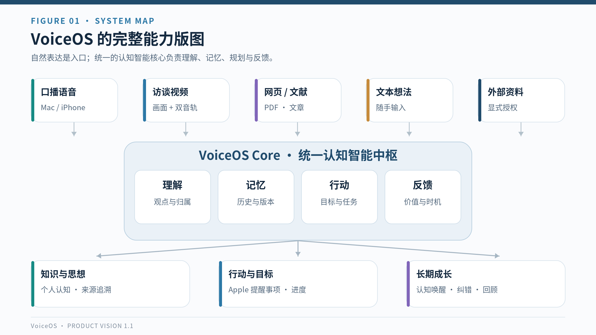
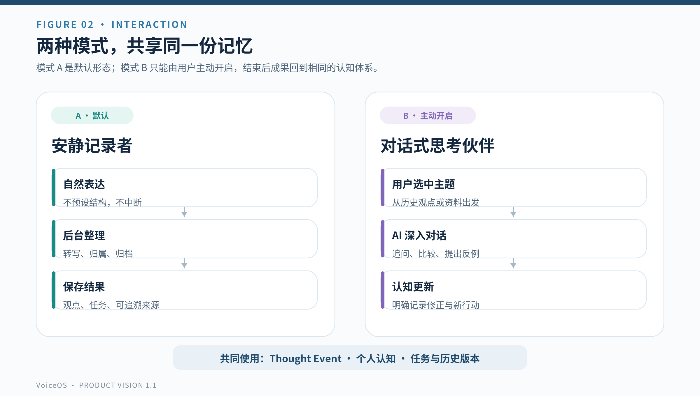
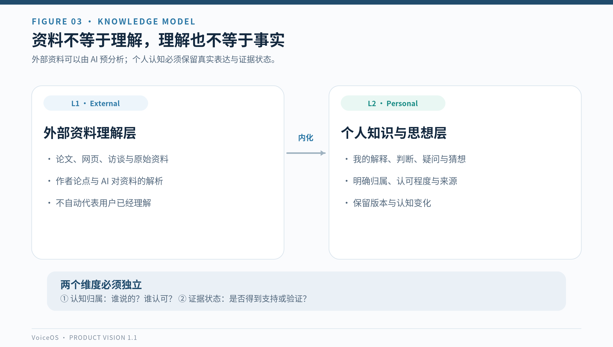
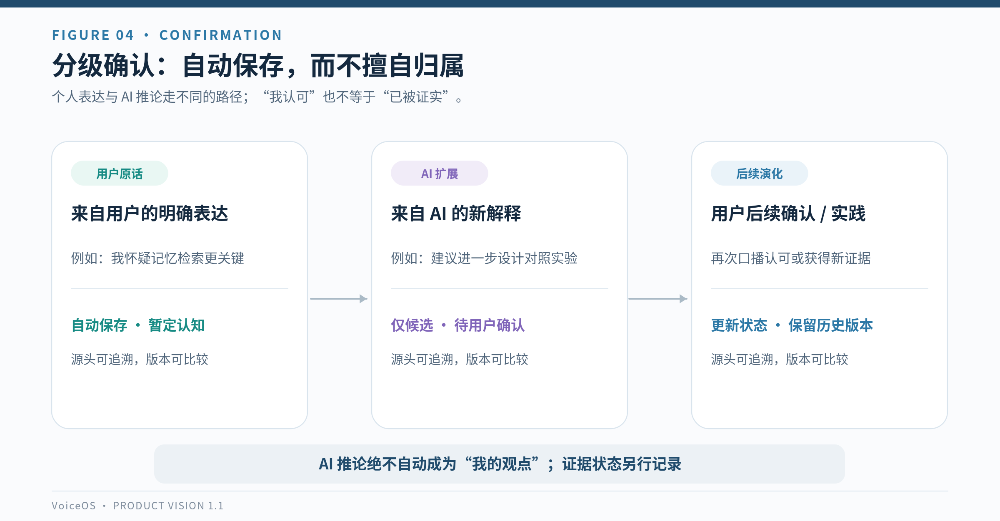
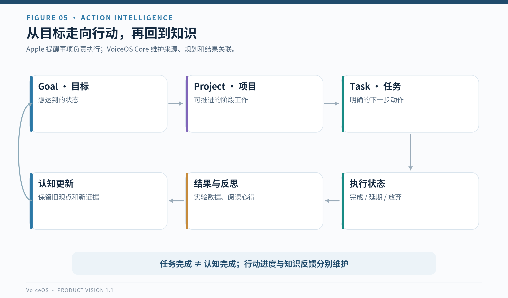
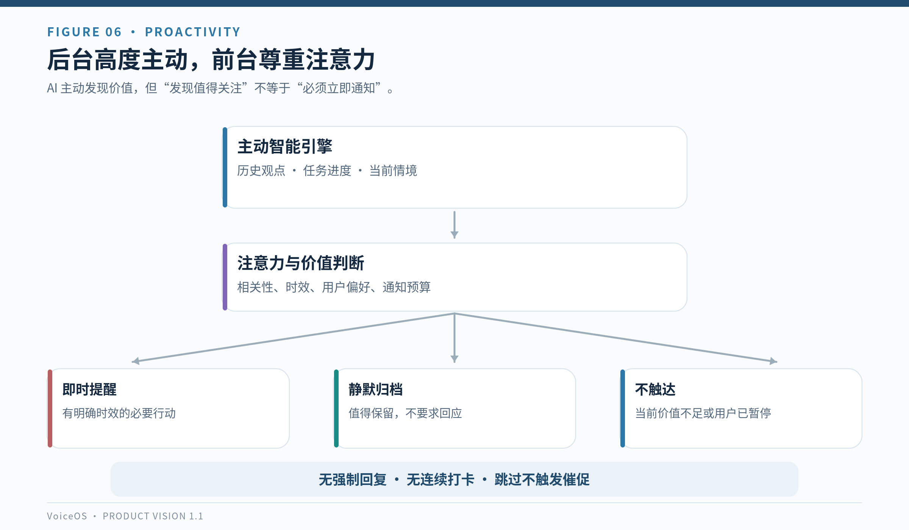
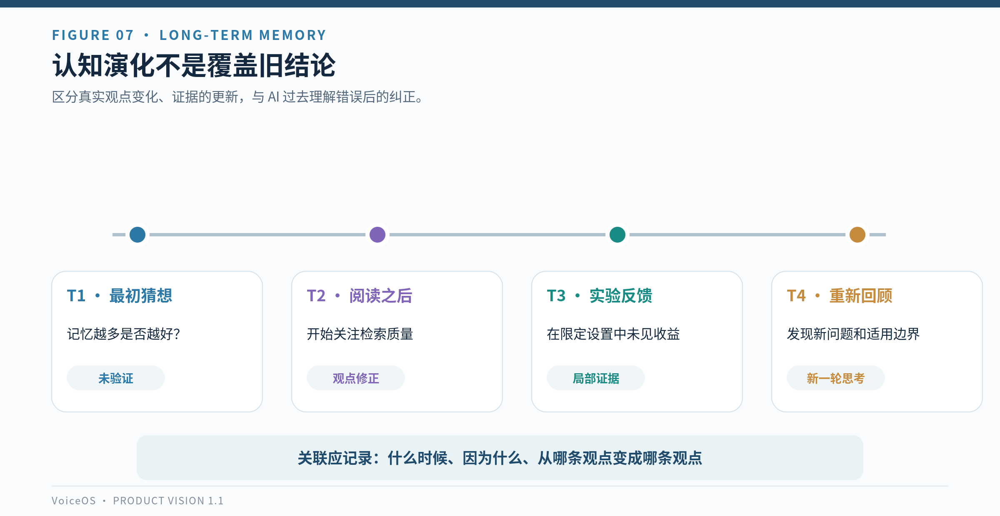
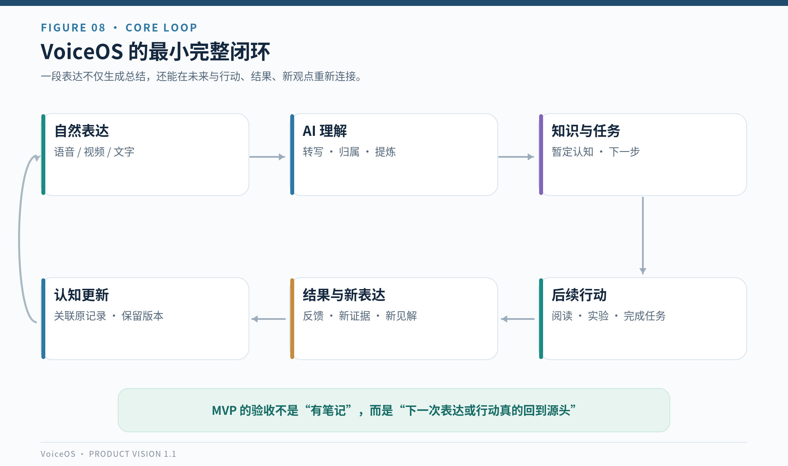
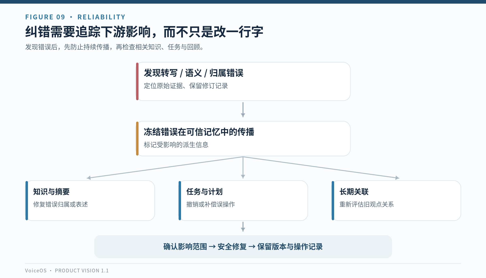
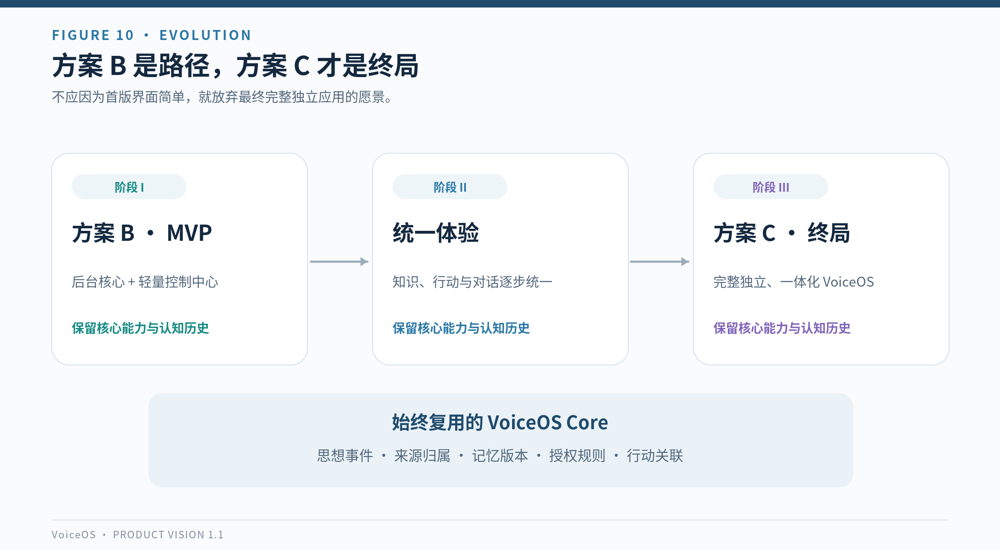

# VoiceOS：产品愿景与概念设计文档

**VoiceOS — Product Vision & Concept Design**  
**版本：** v1.1 · 图文增强版  
**日期：** 2026 年 10 月 10 日  
**文档状态：** 产品愿景基线 · 静态可视化增强（用于指导后续 PRD、交互设计和技术架构）  
**产品定位：** 语音优先的多模态个人智能系统  
**阶段策略：** 近期方案 B（后台智能系统 + 轻量控制中心）；长期方案 C（完整独立、一体化的 VoiceOS 应用）

> **一句话愿景**  
> 让人能够毫无负担地表达，让有价值的思想被忠实理解、长期记住、恰当唤起，并与现实行动形成持续循环。

---

## 文档摘要

VoiceOS 的出发点不是要再做一个录音转文字工具，也不是要开发一个督促用户完成更多任务的效率应用。它源于一个朴素的需求：用麦克风自由讲出学习中的收获、尚不成熟的猜想、日常灵感和生活计划，再由 AI 接手那些耗时、重复、容易中断的整理工作。

随着使用场景扩展，单次录音可能同时包含观点、问题、引用的外部资料、明确的待办、长期目标以及关于过去经历的反思。VoiceOS 的任务是理解这些信息的不同身份，把它们组织进相互关联的知识与行动体系；在未来相关的时刻，帮助用户接续过去的思考，而不是让记录沉睡在文件夹里。

VoiceOS 的核心价值由五个连续动作构成：**捕获表达 → 理解与归属 → 形成知识和行动 → 跟踪后续变化 → 在适当时机反馈**。这一过程以用户真实思想为中心，由 GPT 提供主要认知智能，由可靠的程序负责状态、权限、存储和执行。产品应在后台积极工作，在前台克制触达。

**首版产品（MVP）的要求不是覆盖所有梦想中的功能，而是确实跑通一次跨时间的认知—行动闭环。** 最终愿景则是一个拥有统一交互、知识、任务、记忆、对话和反馈能力的独立个人系统。

## 图示总览

以下静态图示是对正文关键概念的结构化表达；正文中的产品决策、边界与验收要求以文字为准。图表均提供高分辨率 PNG 和可编辑的 SVG 源文件。

***图 1 · VoiceOS 总体能力架构。** 五种典型入口汇入统一的 VoiceOS Core；知识、行动和长期成长是同一认知系统的不同产出。*

---

# 1. 背景、起点与核心问题

## 1.1 起点：表达比整理更自然

用户最初希望通过观看技术访谈、在关键片段暂停并口述自己的见解，提升知识输出和表达能力。延伸来看，麦克风也可以用于记录日常感悟、英语口语练习、研究猜想，以及生活中的奇思妙想。

口头表达比输入一篇条理完整的文章更低门槛。人在说话时可以探索、犹豫、修正、跳跃，不必先把思想整理成熟。但语音和视频天然不利于日后的快速浏览、全文检索和跨时间比较；用户也很难持续回听大量历史录音。

因此，最初需要的是“从语音到可阅读文字”的工作流；进一步需要的是“从随口表达，到可以发展和复用的个人知识”的工作流。

## 1.2 问题并不止于知识记录

一次技术访谈评论可能同时产生：

- 一个新观点：关于某项技术机制的判断。
- 一个悬而未决的问题：目前还缺少哪些证据。
- 一个行动意图：之后阅读论文或设计实验。
- 一段外部上下文：观点来自哪场访谈、哪篇文章。
- 一条长期关联：它与数周前的另一段思考是否有关。

如果只生成一篇摘要，待办仍然需要重新抄写，后续实验结果也无法自然回到原始观点。于是知识、行动和反馈依旧分散在不同工具之中。

VoiceOS 要解决的根本问题是：**思想被记录，却难以被重新发现；行动被计划，却难以反过来促进认知；工具保存了内容，却没有保存内容之间的关系。**

## 1.3 不希望创造的新问题

VoiceOS 不应要求用户为了“管理自己的成长”而持续填写表单、打卡、审阅 AI 总结或完成认知作业。高度频繁的回顾可能制造额外负担：回复会打断更重要的事情；不回复又容易产生亏欠感，最终导致系统被弃用。

因此，系统是否成功，不能以生成多少笔记、创建多少待办或发送多少通知衡量，而要看它是否在低摩擦、低干扰的前提下，长期帮助用户记住重要思想、推进值得执行的目标。

# 2. 产品定位、愿景与边界

## 2.1 产品定义

**VoiceOS 是一套以自然语音为核心入口、融合多模态资料理解、个人知识管理、长期认知记忆、AI 深度对话、智能行动规划与自适应主动反馈的个人智能系统。**

它属于应用层意义上的“个人操作系统”：统一组织个人认知活动与行动，而不是替代 macOS、iOS 等计算机操作系统。

## 2.2 使命

1. **降低表达成本：** 思想出现时，用户可以立即说出来，不必先整理成文章。
2. **忠实形成知识：** 区分用户观点、他人材料和 AI 推断，让记录可靠、可回溯。
3. **连接思想与行动：** 将明确意图转化为可执行步骤，并持续追踪结果。
4. **延续认知过程：** 将新思考与旧记录关联，保留修正、验证和思想演化。
5. **保护注意力：** AI 主动完成后台工作，只在值得的时候打扰用户。

## 2.3 面向的主要使用场景

首要服务个人使用，尤其适合经常口头思考、持续学习、阅读技术内容、开展研究及希望改善表达的人。产品也应能自然覆盖一般生活计划和自我反思，而不是局限在某一专业领域。

典型场景包括技术访谈评论、论文阅读心得、随手灵感、英语口语训练、生活待办、阶段性目标推进、个人反思与历史观点回顾。

## 2.4 与相邻产品的区别

| 相邻工具 | 主要解决什么 | VoiceOS 额外解决什么 |
|---|---|---|
| 录音与转写工具 | 留存声音、生成逐字稿 | 识别思想身份，形成跨时间知识与行动关系 |
| AI 摘要工具 | 提炼单次内容 | 忠实保留用户立场，关联过去与未来 |
| 笔记与知识库 | 保存、编辑、检索资料 | 区分外部资料和个人认知，记录认知演化 |
| 待办应用 | 显示任务、提醒和勾选 | 解释任务来源、规划目标、把行动结果反馈认知 |
| AI 聊天助手 | 回答当前问题、展开对话 | 将独立表达、行动状态和长期记忆统一管理 |

## 2.5 明确边界

VoiceOS 不以“监视一切数字活动”为目标，不默认收集用户访问的所有网站与文件，不把所有收藏资料都视为用户知识，也不把每个模糊愿望自动变成刚性任务。

首版不重建完整的笔记编辑器、任务应用或操作系统；长期愿景虽是独立产品，但不等于未来必须拒绝外部工具。第三方软件可以长期作为可选集成存在。

---

# 3. 十项已经确认的核心产品决策

以下是产品定义阶段已明确选择的方向。其后延伸的具体机制若未单独确认，仍属于设计建议而非不可调整的既定规则。

| 编号 | 已确认决策 | 含义与约束 |
|---|---|---|
| **D01** | **双模式交互** | 模式 A“安静记录者”为默认；模式 B“对话式思考伙伴”由用户主动开启。模式 A 不被 AI 擅自打断。 |
| **D02** | **语音优先、多模态支持** | 语音是核心表达入口；文字、视频、网页、PDF 等可以作为输入或思考上下文。 |
| **D03** | **外部资料与个人知识分层** | AI 可预分析未经用户阅读的资料，但不能将其直接归为用户理解或立场。 |
| **D04** | **个人知识分级确认** | 用户明确表达的观点自动保存为暂定认知；AI 推断作为候选；用户认可或取得证据后再更新相应状态。 |
| **D05** | **高度自主的 AI 行动管家** | 不止提取待办，还应拆解长期目标、安排阶段行动、追踪进度并反馈结果；重要操作保留授权边界。 |
| **D06** | **混合自适应主动反馈** | 行动、认知和关联型主动性并存；后台高度主动，前台低打扰。非紧急反馈不要求回应。 |
| **D07** | **方案 B 是过渡，方案 C 是终局** | 近期以后台智能系统和轻量控制中心验证价值；最终形成完整独立、一体化的 VoiceOS 应用。 |
| **D08** | **智能体验优先、可靠恢复、部署开放** | GPT 提供主要认知智能；目前接受 Mac 休眠暂停、唤醒自动续作；云端常驻不是刚需。充分相关上下文优先于极端数据最小化，同时保留安全控制。 |
| **D09** | **可追溯纠错与记忆修正** | 能纠正转写、归属、理解、知识与行动错误，追踪衍生影响；不抹去真实历史。 |
| **D10** | **首版验证完整核心闭环** | 首版必须从表达走到知识、任务、后续行为和认知更新，不以单次总结作为产品完成标准。 |

### 贯穿十项决策的五条不变量

- **用户思想优先：** AI 不能替用户虚构立场、承诺或已掌握的知识。
- **原始依据可回溯：** 整理后的观点、行动及关系应尽可能回到原始表达或外部材料。
- **无负担地使用：** 不回复、不打卡、暂时离开，不应被系统判定为失败。
- **自主权有边界：** AI 可主动提出和推进，但不可绕过明确授权或高风险操作确认。
- **演进时数据不断裂：** 从过渡形态 B 走向独立形态 C，核心历史、身份和关联不应被丢弃。

---

# 4. 典型用户体验

## 4.1 模式 A：安静记录者（默认）

用户开始录音，讲述技术理解、生活计划或任何尚未成熟的念头。系统不主动追问、不要求提前选择精确分类。结束后它自动转写、分类、提取信息，形成笔记与必要的行动，并将结果送入统一知识与任务体系。

模式 A 的理想体验是：**用户结束录音后即可离开，不必等 AI，不必立即审稿，更不必处理一组系统制造的问题。**

在记录结果中，用户可以看到原始录音、可编辑逐字稿、观点摘要、被识别的任务，以及需要人工确认的 AI 延伸内容；界面默认呈现最简结果，允许按需展开依据。

## 4.2 模式 B：对话式思考伙伴（主动进入）

用户可以从某次录音、观点、论文或研究问题进入对话，例如：“继续讨论上周关于 Agent Memory 的猜想，请提出反例。”

AI 允许追问、澄清、比较历史看法、提出实验设计或新的解释，但需要表明哪些是引用材料、哪些是用户此前观点、哪些是自己的建议。讨论结果回到原有思想事件中，形成新的版本或后续行动。

**主动回顾通知可以邀请用户开启模式 B，但不能自行切换到语音对话或在模式 A 中打断。**

***图 2 · 双模式交互。** 模式 A 不打断用户；模式 B 必须由用户发起。两者共享思想事件、认知历史与任务状态。*

## 4.3 典型场景 A：技术访谈中的认知—行动闭环

以下是虚构的使用案例，用来说明产品行为，而不是实际已发生的记录。

1. 用户观看一段技术访谈，暂停后说：“我觉得 Agent 的记忆容量未必越大越好；以后想查论文验证检索质量的作用。”
2. VoiceOS 保存自己的讲话、访谈来源与对应时间戳，明确区分嘉宾原话和用户评论。
3. 系统记录“检索质量可能比容量更重要”为**用户暂定猜想**；相关实验变量是 AI 提出的延伸建议，而不是用户已确认的结论。
4. 系统识别“查找相关论文”为行动意图，关联该猜想，依照授权规则进入任务体系。
5. 用户完成阅读，随后再口播新的判断；系统将两次思考关联，记录观点延续或变化，而不是覆盖首次表达。
6. 某次未来回顾中，系统可能提出：“这条研究问题后来有了新的证据，要不要重访？”用户可忽略，不需要完成所谓的回顾任务。

## 4.4 典型场景 B：日常灵感

用户偶然想到一种学习方法，随口录下不到两分钟的语音。系统提炼一个暂定想法、保留未明确的部分，并寻找与此前学习反思的联系。如果没有明确的行动承诺，则不必创建待办。数周后出现相关的新口播时，系统可以在处理结果里附上历史关联。

## 4.5 典型场景 C：英语练习

用户用英语讲解熟悉的技术主题。系统保留英文原句，提供语法和表达组织建议，提取少量可复用句型；下一次练习可以参考过去错误的变化。**不能仅凭自动转写文字断言发音质量**，如需评估发音、重音和节奏，应使用实际音频与专门的评估方法。

## 4.6 典型场景 D：生活计划与反思

用户说：“下周想整理书架，周末有时间再安排。”系统识别生活计划和时间偏好，避免无依据地创建硬性截止日期。对于一般事务，完成后仅同步状态；只有当该行动有潜在认知价值，才考虑邀请补充感受或结果。

---

# 5. 产品核心能力体系

## 5.1 捕获层：语音优先的多模态输入

- **核心输入：** Mac 麦克风口播；可导入常见音频和视频录制文件。
- **访谈场景：** 保留用户声音与外部节目声音的来源区别，尽量维护音轨和时间索引。
- **辅助输入：** 文本、网页链接、PDF、图片或视频作为相关上下文；首版可只支持部分形式。
- **移动入口：** iPhone 随时录音是重要演进方向，但完整原生客户端不是首版必要条件。
- **来源控制：** 外部资料通过用户动作或明确授权进入系统，不默认持续监控所有内容。

设计上应按**内容来源与认知身份**区分信息，而不只是按 MP3、MP4、PDF 分类。用户的讲话、第三方访谈、文献正文和 AI 生成内容不能自动混作同一作者的陈述。

## 5.2 理解层：GPT 驱动的认知加工

AI 处理并非一次“生成摘要”调用，而是一组可以独立校验的认知任务：

1. **忠实转写与语义整理：** 去除无意义重复，保留否定、疑问、条件、犹豫和关键技术术语。
2. **表达类型识别：** 区分事实转述、个人观点、猜想、疑问、情绪反思、愿望与行动意图。
3. **观点重建：** 将零散口述组织为有逻辑的笔记；对于缺少证据的部分，明确留白或标注待验证，不制造虚假的论证闭环。
4. **外部背景整合：** 适当引入访谈或论文上下文，标记其来源与证据状态。
5. **AI 深化：** 提出反例、替代解释、实验建议和后续问题；不得自动归入用户的个人立场。
6. **结构化输出：** 结果既适合阅读，也适合长期存储、追踪与后续程序处理。

GPT 是主要的理解、推理和规划引擎；语音转写可以根据设备、体验和成本选择本地或云端方案。AI 输出的成功与否、权限判断、状态写入和任务去重，不能仅凭模型自由文本决定，而应由可审计的程序负责。

## 5.3 双层知识系统

### 外部资料理解层（External Knowledge Layer）

接纳论文、博客、网页、视频及 AI 对这些内容的分析，回答“资料说了什么”。资料被收藏、被 AI 摘要、被用户阅读和被用户认可，是不同事件，不得自动合并为“用户已经理解”。

### 个人知识与思想层（Personal Cognition Layer）

记录用户明确说过的理解、判断、猜想、疑问和随后的修正，回答“用户目前如何理解”。原创灵感即使没有外部资料作为起点，也可以直接进入该层。进入个人知识层不等于已验证正确、完全掌握或坚定赞同。

### 认知状态与证据状态彼此独立

一条观点至少需要两种属性：

- **归属与认可状态：** 用户暂定观点、用户确认观点、AI 延伸候选、外部作者观点等。
- **证据与验证状态：** 未验证、部分支持、存在争议、被反例挑战、在限定条件下验证等。

用户认可的是“这代表我目前的想法”，并不等于科学事实已获证实。反过来，一条可靠的外部事实也不应自动成为用户的个人立场。

***图 3 · 双层知识模型。** 区分资料内容与个人认知；对同一条陈述，认知归属与证据状态必须分别记录。*

## 5.4 认知形成与分级确认

- 用户明确表达的观点、问题或猜想：**自动保存为暂定认知**，附来源和置信提示；不强制立即审阅。
- AI 自行提出的论点、解释与任务方向：**作为 AI 建议或待确认候选**，不冒充用户声音。
- 用户明确认可、重新表述或实践取得证据：**更新相应状态**，保留旧版与变化原因。
- 对存在归属歧义、语义矛盾或高影响风险的内容：允许进入待核对状态，而非直接写入高可信记忆。

AI 不应把每一句口误、转述和即时联想强行提炼成“重要观点”。个人认知层的目的不是堆积条目，而是忠实保存值得追溯的思考过程。

***图 4 · 个人知识分级确认。** 用户明确表达可自动归档为暂定认知，AI 新推论只能成为候选；更新须保留版本与依据。*

## 5.5 行动系统：目标、项目与任务

VoiceOS 应区分三个层次：

| 层次 | 说明 | 例子 |
|---|---|---|
| **Goal（目标）** | 想达到的状态或方向 | 能用英语清楚讲解技术问题 |
| **Project（项目）** | 达成目标的阶段性工作组织 | 一轮四周技术英语表达训练 |
| **Task（任务）** | 可被执行、完成、推迟或取消的动作 | 录制一次三分钟英文讲解 |

系统应能够从口播中识别明确任务、长期目标、探索性意图和 AI 自行建议。对于长期目标，AI 可以主动拆解、排序、提出适合的行动节奏，必要时结合已授权的时间与任务背景动态调整。

VoiceOS 同时承担个人助理角色：对用户明确委托的调研、比较与起草，在已授权的资料处理范围内直接推进并交付结果，而不只记录待办。识别到计划或想法不等于已经委托执行；关键条件不足时说明缺什么，外部发送、购买与重要操作仍需相应授权。AI 交付物保留来源与归属，可接回相关主题继续讨论；交付完成、用户采纳和实际行动结果分别记录。

不应一次性把所有候选步骤全部变成带提醒的任务。系统需要有**行动机会池**，承载值得考虑但尚未承诺执行的想法。

### 与 Apple 提醒事项的关系

在过渡阶段，**Apple 提醒事项是主要任务执行界面**；VoiceOS 是目标规划、来源关联、动态调整和结果反馈的智能中枢。用户在提醒事项中勾选完成后，VoiceOS 应能在权限和同步条件允许时获知任务状态。

“任务已勾选完成”不等于“目标达成”，更不等于“用户已获得知识”。行动状态与认知反馈状态应独立记录；对于普通事务，完成本身足够，对于阅读、实验、学习等任务，可以适时提供可跳过的结果反馈入口。

***图 5 · 自主行动闭环。** 目标、项目、任务与结果形成分层关系；完成动作不自动等于产生新知识。*

## 5.6 主动反馈：行动、认知与关联并存

VoiceOS 的主动智能有三个维度：

- **行动型主动性：** 发现到期任务、停滞目标和可执行的下一步。
- **认知型主动性：** 唤醒长期未重访的观点、问题、猜想和成长线索。
- **关联型主动性：** 发现新表达与历史记录的支持、冲突、延续或潜在联系。

其中**认知唤醒（Cognitive Resurfacing）**不等于对所有笔记做机械的间隔重复。它应回答“这条旧思考为什么值得在现在出现”。候选因素包括当前相关性、未解决程度、新证据、用户重视程度、时间间隔与此前触达反馈。

### 混合自适应触达策略

| 触达层级 | 默认策略 |
|---|---|
| **即时提醒** | 用于明确时间要求或高时效事件，在授权范围内执行。 |
| **静默回顾** | 后台持续形成可按需查看的关联和简报，不必每天生成有内容的报告。 |
| **价值驱动通知** | 只有潜在价值足够高时才主动通知；可跳过、不要求回答。 |
| **情境内反馈** | 新录音或新讨论与历史观点相关时，优先附在本次处理结果，而不是额外推送。 |

工作日下班后可作为一个**候选关注窗口**，但不应承诺每天一定发送认知回顾。默认逻辑应由事件价值和注意力预算决定，而非每日打卡。每周回顾亦应是可选或有内容才出现。

用户可以选择稍后、减少类似提醒、暂停某主题的主动反馈或彻底关闭相应通知。长期不回应不能自动解释为放弃兴趣，更不能触发带有羞耻感的催促。

***图 6 · 混合自适应主动反馈。** 后台持续发现信息价值，前台再判断即时提醒、静默归档或不触达。*

## 5.7 历史观点与个人认知时间线

同一问题可能跨越数天、数月或数年被重新讨论。VoiceOS 应将这些表达关联为可追溯的认知历史，并区分：

- 用户观点确实发生了变化；
- 用户立场未变，但论证更加充分；
- 一条旧观点被新的证据限定或推翻；
- AI 曾经理解错误，现已被纠正。

系统不能把 AI 的历史误解误报为用户的“成长轨迹”。长期可演进出个人认知时间线，用于回答“我为什么改变看法”“哪些问题一直没有解决”“以前的哪些思想在最近重新变得相关”。

个人知识图谱以**主题与问题**为主要组织入口，跨时间连接连续几周乃至几个月的探索。时间用于解释认识形成与变化，不把同一主题按周切断；**日、周、月**作为周期性回顾，汇集各主题在这一周期的新进展，并可回到完整主题脉络。认知时间线与主题图谱共同呈现：把接触过的材料、认知想法、学习内容、行动与实际成果连接起来，帮助用户看见“这一段时间我关注了什么、有哪些收获、不同认识之间有什么联系与区别、完成了什么”。每个节点可以回到原话或实际记录；旧资料作为背景接入，任务完成与获得知识分别表达。

VoiceOS 与用户是协作关系，是持续生长的个人系统。AI 应帮助用户跨主题总结、比较认识、发现矛盾与未解问题，从更高层次提出可验证的新理解，使学习不断迭代。AI 推论与用户判断分开，新增联系保留依据并允许继续讨论、更正和停止使用；不能用漂亮的关系图替代真实理解。这一方向逐步完善，不预先冻结图谱算法或完整架构。

**稳定的功能内核与美观、清晰、可操作的界面同等重要**：完整保留表达、正确理解和反馈回流是基础；顺手的周期切换、关系探索与回顾互动使这些积累真正可用。

长期探索以用户真正关心的**主题与问题**为入口，主题承载持续关注的领域，问题承载具体疑问；不要求表达前先完成分类，逐渐关联材料、个人判断与实践。日回顾找回思考现场，周回顾辨认联系、条件差异与未解问题，月回顾依据真实前后表达呈现认识变化。认识变化保留原话与促成变化的依据，由用户记录或确认；AI 关系候选与转写纠错分别标明。

AI 的跨主题联系应展示两侧依据、共同机制、差异及类比失效的边界，允许用户核对、寻找反例和修正。值得验证的判断可以接到一次小尝试：检验什么、如何尝试、观察什么、什么结果会促使修正；实际结果再接回问题，完成状态与学习结论独立保存。界面围绕问题和局部关系展开，从简短回顾可逐步走回完整原文与历史，避免要求用户先整理分类才能表达。

***图 7 · 跨时间认知演化。** 记录猜想、阅读、实践与再讨论的演化链，不能将 AI 纠错冒充为用户观点变化。*

---

# 6. 统一认知模型与核心工作流

## 6.1 核心组织单位：思想事件

VoiceOS 应以**思想事件（Thought Event）**而非单一文件作为核心组织单位。一次阅读、访谈评论或日常反思，可能包含多个音频片段、外部材料、观点、任务和后续成果；这些对象应可被统一追踪。

> 思想事件不是强制用户手动创建的文件夹，也不意味着必须使用某种图数据库。它是产品层面的统一身份与关联模型。

### 概念性实体

| 实体 | 用途 | 必须保留的重要关系 |
|---|---|---|
| **Thought Event** | 一次或一组相关的认知活动 | 时间、主题、参与内容、关联后续事件 |
| **Source** | 录音、视频、网页、论文等原始依据 | 来源身份、位置、时间戳、权限 |
| **Transcript / Extract** | 从来源提取的文本及片段 | 具体来源与原始时段 |
| **Claim / Question** | 用户观点、疑问、猜想、外部主张或 AI 推论 | 归属、认知状态、证据状态、版本 |
| **Goal / Project / Task** | 行动体系中的目标、项目与任务 | 意图来源、授权、进度、执行结果 |
| **Reflection / Outcome** | 阅读、实验、练习或生活行动的反馈 | 对应任务、来源、产生的新认识 |
| **Relation / Revision** | 支持、矛盾、引用、修正、衍生等联系 | 参与对象、时间、证据与修订理由 |

这些信息构成 VoiceOS 的自有认知数据；思源笔记、Apple 提醒事项等是早期的重要呈现与执行工具，但不能成为唯一承载身份关系的地方。

## 6.2 标准闭环

*图 8 · 完整核心闭环。后续表达和任务结果必须重新回到已保存的思想事件，而不是仅创建新的孤立笔记。*

**完整闭环的最低判据：** 用户的一次表达可以形成可追溯的知识和行动；后续一次真实的任务完成或新表达能够关联回源头，并更新相关认知或行动状态，而不是另开一份孤立笔记。

## 6.3 一个事件可产生多种结果

同一录音不应被强制分类成“只有知识”或“只有任务”。它可以同时产生：

- 一份经过忠实整理的结构化笔记；
- 若干个人暂定观点或待验证问题；
- 一个明确任务或一个探索性行动候选；
- 对外部资料的引用或背景索引；
- 与历史思考的可能关联；
- 一份 AI 建议，等待用户决定是否采纳。

所有产物都应能够回到原始表达或明确说明它们是 AI 推导；衍生内容不应反向污染原始记录。

---

# 7. 人机协作、主动权与注意力

## 7.1 决策权归属

VoiceOS 的高度自主应理解为：**较高的分析、规划与跟进自主权，加上受约束的执行权限。**

建议的权限模型如下；具体动作阈值须在 PRD 中进一步明确。

| 行为 | 推荐控制方式 |
|---|---|
| 转写、整理、建立来源索引、生成 AI 候选 | 在授予的内容处理权限内自动执行 |
| 从明确口播提取普通待办 | 可在已授权的 VoiceOS 任务范围内自动执行 |
| 长期目标拆解、形成候选计划 | 自动生成，逐步激活任务，不强制一次性承诺全部安排 |
| 调整弹性任务的推荐顺序 | 在用户允许的范围内自动执行 |
| 更改明确承诺的期限、批量删除、取消重要目标 | 请求确认 |
| 代用户发送外部消息、付费、公开内容、做不可逆承诺 | 必须单独授权，并提供结果记录 |
| 改写用户立场、把 AI 假设升级为用户观点 | 不得静默执行 |

智能建议与真实执行要有明确边界。AI 可以建议“下周试验这个方案”，不代表用户已经承诺执行。

## 7.2 非回应不是异常

对认知回顾、主动洞见和非紧急建议，VoiceOS 的默认交互应满足：

1. 用户不回复，系统仍已完成有价值的后台整理；
2. 不生成因“未回答”而累计的认知债务；
3. 不以连续天数、答题次数或互动时长迫使用户保持活跃；
4. 同一主题多次被忽略时，系统可以减少触达，但不能据此判定用户不再重视它；
5. 用户可随时暂停整个主动反馈或部分主题，之后自然恢复。

## 7.3 主动反馈与模式 B 的边界

系统可以说“发现一条与旧观点相关的新线索，是否想讨论？”，但只有用户实际选择讨论，才开启模式 B。默认模式 A 中不发生未经邀请的语音追问。

---

# 8. 数据、智能、可靠性与纠错

## 8.1 本地与云端：以体验要求而非技术标签驱动

现阶段已确认的体验要求为：

- 用户录制完毕后可以直接合上 Mac；
- 原始文件与处理任务状态必须可靠保存；
- Mac 睡眠期间允许暂停本地处理；
- 下次唤醒及网络恢复后，未完成任务应自动续作；
- 不要求为了休眠期间持续计算而立刻购买常驻服务器；
- 长期可选择云端独立执行，但这不是首版必须能力。

需要明确“可靠恢复”不是“所有结果立即可用”。程序必须能区分等待、执行、失败、待重试、完成及等待同步等状态；无法在设备离线时完成的设备端操作可以继续排队。

## 8.2 GPT 的角色与上下文策略

GPT 是主要的观点理解、复杂推理、目标规划与认知反馈引擎。未来可按任务复杂度选用不同 GPT 模型以平衡质量、时延和成本。

转写校正默认由 GPT 阅读完整转写并直接完成，明确修正自动采用，不默认增加本地复听、多轮裁决或逐项人工审核。AI 校正成功后只保留校正稿，不另存自动校正前的全文或逐条修改旧文；确实无法确定的内容保留疑义；纠正识别错误与核查用户知识判断分开。程序负责完整接收模型结果、保留实际终态和可靠续作，不用任意等待时长代替成功或失败判断。默认由 AI 一次完成同一职责，不把多次生成、独立投票或裁决设为普遍门槛；复查应解决具体的全文漏项、出处或事实查证问题。阶段中间副本在结果接纳后清理，只保存有实际用途的当前内容、关系和结果依据。

产品优先保证 GPT 获得**充分、相关、准确且在授权范围内可用**的历史上下文。不为极端本地化或机械地减少输入而明显损害认知质量。

但“完整长期记忆”不等于“每次把所有录音与笔记全部发送给 GPT”。系统应按任务意图检索相关观点、来源、行动和证据，必要时扩大检索范围；既保留历史完整性，又控制无关信息、时延和费用。

## 8.3 数据主权与隐私保护

用户明确优先考虑高质量智能体验，同时期望可信的隐私保障。建议的产品原则是：

- 对核心记录拥有可导出、可备份、可迁移和可删除的控制能力；
- 在明确授权范围内使用云端模型，说明发送的数据类型与处理目的；
- 保留用户自行指定特别私密或仅本地处理内容的能力；
- 将权限约束落实到实际数据处理与上传行为，而不只是界面标签；
- 对外部服务的数据保留、删除与使用规则如实说明，不做超出服务保障范围的承诺；
- 原始大型音视频和结构化文本可采用不同存储策略，但来源关系不能断裂。

“默认允许 GPT 使用足够相关的个人上下文”是体验方向，**不是允许无限收集资料或绕过用户知情授权**。

## 8.4 可靠执行与失败恢复

首版至少应拥有：

- **原始数据保护：** 未核实完整保存前不删除原始录音；
- **持久任务状态：** 进程关闭、设备休眠或断网后可继续；
- **幂等和去重：** 重试不导致重复创建笔记或提醒事项；
- **可见失败：** 失败任务进入可恢复队列，提供清楚的原因与重试入口；
- **外部写入确认：** 对第三方应用的写入不能仅凭“已经发出请求”认定成功；
- **分层日志：** 技术日志与用户可理解的处理状态分开呈现。

## 8.5 四层纠错与记忆修正

| 纠错层次 | 典型错误 | 应有修复行为 |
|---|---|---|
| **转写层** | “不要”识别成“要” | 修改文本，保留音频及修订记录 |
| **语义层** | 把质疑当赞同、把转述当观点 | 更正理解、归属与认知状态 |
| **长期记忆层** | 错误进入历史画像与关联检索 | 阻止错误继续被高可信使用，检查衍生内容 |
| **行动层** | 错建任务、错误变更计划 | 撤销或补偿可逆操作，对不可逆影响如实说明 |

**必须区别 AI 错误与真实认知变化。** 过去观点后来被用户否定，是思想演化；AI 曾错误记录观点，则应当纠错，不能将其当作一次成长记录。

纠错流程应支持“确认问题 → 冻结错误影响 → 找出衍生依赖 → 自动修复可确定部分 → 对重要变更请求确认 → 保留修订史”。用户可直接用自然语言发起纠错，例如“你理解错了，我刚才的意思不是这个”。

***图 9 · 纠错影响传播。** 错误一经确认，应先阻断可信记忆传播，再检查知识、任务和长期关联中的派生影响。*

---

# 9. 产品形态与演进路线

## 9.1 终局与过渡的区别

**长期形态 C：完整独立的 VoiceOS 应用。** 统一承载录音、资料、思想、任务、AI 对话、认知时间线和主动反馈，逐渐能够在自身应用内完成主要体验；Mac 是主要起点，移动端是自然延伸。

**阶段性形态 B：后台智能系统 + 轻量控制中心。** 通过现成工具提供阅读、任务执行和录音能力，VoiceOS Core 负责统一理解、关联、状态与规划。这个形态是明确的过渡，不应被误写为产品终局。

## 9.2 首版交互形态建议

控制中心只需承担少量高价值入口：

- 开始/结束自由录音，查看处理状态；
- 查看最近的表达、笔记及原始来源；
- 查看目标、任务和待确认事项；
- 查看值得关注但无需处理的历史关联；
- 从某条记录主动开启模式 B；
- 快速更正 AI 误解及管理相关权限。

**控制中心不是需要每天维护的仪表盘。** 没有待处理事项时，用户应该能放心关闭它，后台继续工作。

## 9.3 分阶段演进

| 阶段 | 主要目标 | 判断是否可以前进 |
|---|---|---|
| **阶段 I：完整闭环 MVP** | Mac 录音与导入、GPT 理解、知识归档、任务执行反馈、基础历史关联和纠错 | 真实场景能够反复完成认知—行动循环 |
| **阶段 II：统一体验深化** | 改进轻量控制中心、认知浏览、跨时间回顾、模式 B 和自主规划 | 用户无需频繁跨应用整理；历史知识在新场景中确实有帮助 |
| **阶段 III：独立 VoiceOS** | 独立知识/行动界面、完整认知时间线、跨设备体验、更丰富的多模态交互 | 外部工具由必要依赖变成可选连接，核心数据与历史无损迁移 |

从阶段 B 发展到 C 时，可以替换界面和集成代码，但应尽量保持稳定的核心实体身份、关联关系、历史版本与授权规则。

***图 10 · 从方案 B 到方案 C。** 渐进式建设交互体验，同时尽量维持同一套核心认知模型与历史记录。*

---

# 10. MVP 范围、验收标准与成功判据

## 10.1 首版必须具备的能力

| 模块 | MVP 最低交付边界 |
|---|---|
| **录制与导入** | Mac 语音录制；可导入音频与录制视频；保留来源；支持处理状态恢复 |
| **AI 理解** | GPT 提炼用户观点、疑问、任务意图；区分外部主张和 AI 补充 |
| **知识记忆** | 原始记录、暂定认知、简单关联、版本历史、检索与来源回溯 |
| **行动系统** | 基础目标与任务提取；与 Apple 提醒事项建立执行连接；反馈完成状态 |
| **闭环更新** | 后续口播或执行反馈能关联既有记录并更新知识或计划 |
| **双模式** | 模式 A 完整可用；模式 B 可围绕历史记录开展基本对话 |
| **主动反馈** | 可静默呈现相关历史观点和未完成问题；非紧急反馈不要求回应 |
| **可靠与可控** | 基础去重、失败重试、唤醒恢复、纠错、权限与操作记录 |

注意：首版的行动自主能力可以先限于普通任务的提取、目标拆解和有限调整；“高度自主”是已确认的长期行为方向，不代表 MVP 要承担所有跨应用执行权限。

## 10.2 明确延期的能力

- 完整 Mac 与 iPhone 双端原生应用；
- 实时、持续、低延迟的全双工语音 AI 对话；
- 复杂认知图谱的可视化和自动知识研究系统；
- 完整自主的多应用电脑操作与日程资源优化；
- Mac 休眠期间仍独立处理的云端常驻后端；
- 对全部历史信息持续自动重评估的高成本后台流程。

延期不代表放弃，应在核心数据和接口设计上预留演进空间。

## 10.3 三个必须跑通的端到端验收案例

### 验收案例 A：技术访谈与研究行动

录制观点 → 提取待验证猜想和普通阅读任务 → 在任务应用中完成阅读 → 再次口述结果 → 系统找到源头、建立新旧观点关系并更新状态。最终每一步都有可追溯依据。

### 验收案例 B：灵感的跨时间复用

记录未成熟想法 → 自动保存为暂定认知 → 若干天后录入相关新想法 → 系统识别有依据的关联、避免把 AI 猜测当成用户立场 → 用户可回听并主动继续讨论。

### 验收案例 C：英语表达的反馈循环

录制英文口播 → 保留原句、生成表达建议 → 下次训练借助旧反馈 → 查看相似错误是否再次出现。若无音频发音评估能力，则不展示误导性的发音评分。

## 10.4 第一版建议的质量门槛

以下是**开发初期的拟定验收指标**，不是已实现成绩，也不是未经测试就必须固定的承诺。上线前应结合实际语料、样本量和风险等级调整。

| 指标 | 初步目标或验收思路 |
|---|---|
| **录音可靠性** | 测试期间零已确认的原始录音丢失；崩溃/休眠后能找回未完成任务 |
| **处理可靠性** | ≥95% 的有效测试录音无需人工修复即可处理完毕或自动重试后完成 |
| **观点忠实性** | 建立否定、条件、转述、引用的专门回归测试；严重归属错误须可追溯且可阻断传播 |
| **任务准确性** | 对明确行动与模糊愿望分别评估误建、漏建；不能用任务总量衡量好坏 |
| **闭环完整性** | 任务与观点能双向追踪到来源；后续表达可以更新既有记录而非仅创建新记录 |
| **纠错能力** | 用户修改核心误解后，错误不继续作为可信记忆被检索；已受影响内容可评估修复 |
| **注意力保护** | 非紧急认知推送零强制回复；跳过后不产生重复催促或惩罚感提示 |

## 10.5 建议进行四周真实使用验证

以自然使用为主，不设置必须每天打卡的要求。可以观察：

- 随机抽查笔记的忠实程度、逻辑清晰度和实际复读意愿；
- 至少尝试数次“旧观点被重新使用”的实际场景；
- 记录至少三条有意义的“表达—行动或再次表达—认知更新”完整案例，作为初期验证目标；
- 观察用户是否因任务或主动反馈产生额外负担；
- 记录 GPT 调用成本、处理时延、错误与纠错耗时；
- 以用户主观判断作为重要指标：是否更愿意自由表达？是否更容易找回过去的思想？是否愿意长期使用？

**最终成功判据：** VoiceOS 不是让用户“管理”了更多内容，而是让其能够以更少的额外操作，保有更完整的思考历史，并将其中真正有价值的部分落实为行动。

---

# 11. 风险、矛盾与设计防线

| 风险或矛盾 | 可能后果 | 产品层面的防线 |
|---|---|---|
| 自动总结过度补全 | 把模糊猜想写成确定结论 | 忠实稿与 AI 延伸分离、保留不确定性、引用原始依据 |
| 外部资料污染个人知识 | 系统错误理解用户观点 | 来源归属分层、分级确认、可追溯修订 |
| 待办数量膨胀 | 想法越多，负担越大 | 行动机会池、目标分层、只激活少量下一步任务 |
| 过度主动提醒 | 不回复产生压力，最终弃用 | 混合自适应触达、静默优先、允许不回应和暂停 |
| 错误在长期记忆中传播 | 后续建议和行动建立在错误基础上 | 记录依赖、阻断错误检索、影响分析和版本修正 |
| 休眠或网络中断 | 工作流暂停或重复执行 | 原始保存、持久任务、自动续作、幂等去重 |
| 长期上下文膨胀 | 成本、时延、无关信息干扰 | 完整记忆与选择性检索分离，按任务提供充分相关上下文 |
| 第三方应用依赖 | 未来迁移困难 | VoiceOS 自有实体身份、标准化导出、外部适配层 |
| 过早开发完整 UI | 精力耗在界面而非价值验证 | 从 B 过渡，以真实闭环判断是否推进 C |
| 对个人数据过度采集 | 隐私与信任风险 | 明确授权、访问控制、可导出与删除、透明云端处理边界 |

---

# 12. 尚未冻结、留待 PRD 和架构阶段解决的事项

下列问题有方向但尚无充分依据，不应在本愿景文档中假装已经定案：

1. **具体 AI 模型与预算：** GPT 的具体型号、不同任务的路由策略、每月成本目标。
2. **转写后端：** 本地和云端语音识别的准确率、延迟、专业术语适应性比较。
3. **录音入口细节：** Mac 菜单栏应用、快捷键、OBS 多音轨、iPhone 快捷指令的实现与权限。
4. **隐私交互细则：** 默认授权的具体范围、敏感内容识别的可靠性、云端服务的保留期限与删除流程。
5. **任务管家权限：** 哪些任务可自动创建、排期或重排；日程冲突如何处理；审批阈值是什么。
6. **主动触达参数：** 价值判断、每日通知预算、工作日关注窗口、每周回顾触发条件。
7. **知识关联算法：** 跨时间主题识别、矛盾检测、误关联复核和长期记忆检索质量评价。
8. **数据存储与同步：** 具体数据库、文件组织、备份、迁移方案以及日后跨设备一致性。
9. **Apple 提醒事项和思源笔记集成：** 接口能力、权限、双向同步、冲突与失败恢复方案。
10. **MVP 指标阈值：** 需要用真实录音样本和实际使用反馈修订质量、频率和延迟要求。

这些事项应按影响程度进入后续 **PRD（产品需求文档）**、**交互规格**、**技术架构设计** 和 **测试计划**，而非阻碍愿景文档定稿。

---

# 13. 产品原则总述

经过产品定义阶段，VoiceOS 可以用以下原则概括：

1. **表达先于整理。** 人可以以自然、零散、不成熟的方式说出想法。
2. **思想重于文件。** 以思想事件及其关系组织知识，而非仅归档音视频。
3. **个人认知与外部信息分离。** AI 解释资料，不等于用户已经理解或认可。
4. **保留思想的生成过程。** 暂定判断、疑问、证据和修正都值得被记录。
5. **认知与行动相互促进。** 任务来自思想，行动结果也能改变思想。
6. **高度自主，不越权。** AI 可以主动规划，但重要决定仍应由人作出。
7. **积极工作，克制打扰。** 系统主动管理遗忘，不制造持续回应义务。
8. **可信比漂亮重要。** 来源、纠错、恢复与审计是核心产品能力。
9. **智能质量与数据控制兼顾。** 让 GPT 获得充分相关上下文，同时让用户知道并控制数据如何使用。
10. **先闭环，再完整。** 以方案 B 起步，围绕稳定的 VoiceOS Core 逐步实现长期方案 C。

---

## 结语：VoiceOS 想创造的体验

使用 VoiceOS 的人，不需要把自己训练成一个擅长做笔记、安排任务、维护知识库的人。他可以在看完访谈时随口说出疑问，在散步时记录灵感，在英语练习中暴露错误，在忙碌时暂时搁置一个研究计划。

系统不会要求这些内容立刻变成精美文章，也不会强迫每个想法都成为行动。它会忠实保存原始思想，适时整理和关联，在真正值得的时候重新呈现；当用户决定执行时，它帮助规划下一步；当新的实践和理解出现时，它把这些变化放回原来的认知历史。

最终，一次录音不再只是一段存档，一项待办不再只是一个勾选框，一次认知回顾也不再是一份必须完成的作业。

**VoiceOS 希望成为一种长期、可信、低负担的人机协作方式：让思想不轻易流失，让行动不脱离理解，让过去的自己能够持续帮助现在的自己。**

---

### 附录 A：核心术语

- **VoiceOS Core：** 不依赖具体用户界面的认知、记忆、行动与反馈核心系统。
- **模式 A / Quiet Recorder：** 默认的无打断记录和自动处理模式。
- **模式 B / Thinking Companion：** 用户主动开启、围绕记录与资料进行深入思考的对话模式。
- **Thought Event（思想事件）：** 将一次认知活动中产生的来源、观点、任务、反馈组织为相互关联的单位。
- **External Knowledge Layer（外部资料理解层）：** 存放外部资料及其可追溯解析的知识空间。
- **Personal Cognition Layer（个人认知层）：** 存放用户自身表达、判断和认知历史的知识空间。
- **Graded Confirmation（分级确认）：** 按用户原话、AI 推断和用户认可程度区别保存认知结果。
- **Cognitive Resurfacing（认知唤醒）：** 在相关时机将有价值的历史思想重新呈现。
- **Action Opportunity Pool（行动机会池）：** 保存有探索价值但未必形成正式承诺的行动候选。
- **Adaptive Proactivity（自适应主动性）：** 根据价值、时机、权限和注意力预算决定是否触达。
- **Cognitive–Action Loop（认知—行动闭环）：** 表达、知识、行动、结果、认知更新的持续循环。

### 附录 B：文档范围声明

本文件是 **产品愿景与概念设计**，用于冻结主要价值判断、产品目标与能力边界。它不是最终 PRD、技术实施方案、成本预算书或对某个模型能力的性能承诺。文中的实例为说明性情境；成功指标为拟定的验证起点，需要通过后续测试校准。
