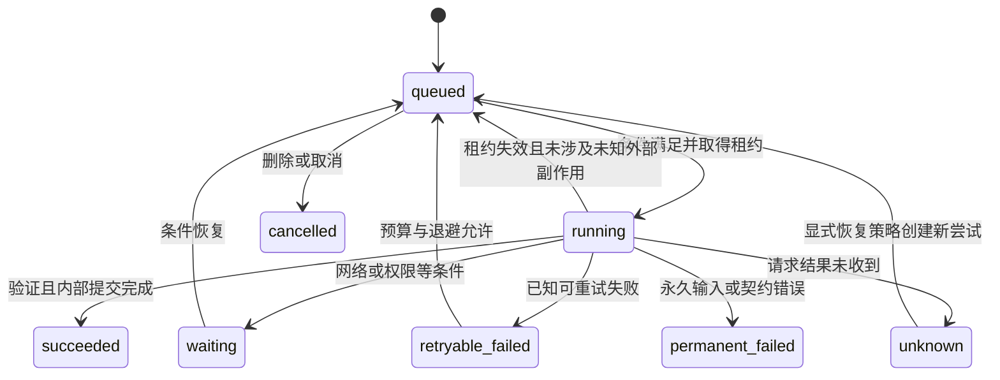

# VoiceOS 状态机与恢复 v0.1

日期：2026-10-10。状态：工程草稿，未实现。适配器和数据库候选见[架构](system-architecture.md)及[ADR](../adr/README.md)，字段见[数据模型](data-model.md)。

## 1. 状态分层

Source 保存状态、Job 处理状态、Operation 外部结果、Task 业务状态、认知归属/证据/有效性独立。一个录音 saved 可以同时是理解失败和同步未开始；一个 Task completed 不使 Claim verified。用户界面按这三个进度维度组合呈现，不显示一个误导的“全部成功”。

所有迁移持久记录原因、旧/新版本、触发身份及时间。状态名是工程枚举候选，非产品新增流程；不要让 GPT 直接写状态字符串。

## 2. Source 保存状态

| 状态 | 进入条件 | 允许后续 | 用户可见含义 |
|---|---|---|---|
| receiving | 保存意图已记录，录制/复制进行中 | sealed、interrupted、failed | 录制中/接收中 |
| sealed | 停止/复制结束，片段范围、长度及摘要已登记 | saved、quarantined | 正在核实保存，尚未承诺完整 |
| saved | 原件存在且容器/长度/摘要核对，DB 来源与转写 job 已提交 | 新处理 job；删除 | 原始资料已保存，理解另显示 |
| interrupted | receiving 中断，可能有可恢复片段 | 新版本封存可恢复范围；failed | 保存中断，显示已保留范围 |
| quarantined | 文件缺失、摘要不符或容器不可判定 | 修复/重新导入后新资产版本 | 资料需修复，禁止送理解 |
| failed | 无法保存或接收永久失败 | 用户重录/重新导入的新尝试 | 没有完整保存，原因可见 |

恢复不能把存在 `.partial` 当作完整录音。恢复出有效前缀时生成带 `completeness=partial` 和真实时长的资产/来源版本；用户可继续使用已保留部分，但界面不能声称整段获救。原件封存后不可覆盖，转码/拼接都是衍生资产。

写入顺序候选：意图事务 → 片段写入/持久化 → 封存索引与摘要 → 文件落到最终位置 → saved + job 同一 DB 事务。文件与 DB 不原子；启动扫描能处理每个窗口。真实容器、目录持久化、磁盘耗尽与睡眠尚待测，合成字节探针没有证明这些性质。

## 3. ProcessingJob 状态

`succeeded` 表示内部 stage 产物已提交，不代表后续任务外写完成。job 的逻辑身份稳定，attempt 每次不同；输入来源版本/阶段/参数版本变更生成新逻辑 job，旧 job 不覆盖新认知。

图展示主要迁移；删除/取消/输入失效可将任一未成功 job 标为 cancelled，并拒绝晚到内部提交。已发出的云请求不能靠此状态撤回，潜在计费仍保留；外部副作用使用独立 Operation 核对。

运行者取得 `lease_owner/lease_until/lease_epoch`；DB 写入要匹配租约 epoch 与预期对象版本。系统休眠期间时钟/连接可能变化，唤醒对过期租约重新核验，不假装工作持续发生。首版单 writer 串行内部提交；也必须防止旧回调晚到写入。

纯读取/确定性转写或内部处理允许在恢复条件和预算内重试；云端生成 unknown 可能计费，不归零费用。后续生产重试需有配置的尝试/费用边界、记录新 attempt，不把探针的“无自动重试”误写成产品永远手动恢复。当前第三方价格未知，探针已在超时/503处停止。

| 失败类型 | 分类/动作 | 禁止的处理 |
|---|---|---|
| 缺语言资源、网络离线、权限未授予 | waiting + 原因；资源下载需用户可见配置 | 暗中上传原始音频或绕开仅本地限制 |
| 已知限流/暂时服务错误 | retryable_failed，候选指数退避与 jitter；次数/费用设置待 P05/H01 | 紧密无限循环、任意改代理 |
| 输入/输出契约错误、损坏容器 | permanent_failed 或待核对；保留原件 | 用部分 JSON 当有效认知或无限同参重试 |
| 模型请求超时/失去回调 | unknown，记录潜在费用；按恢复策略新 attempt | 声称服务未执行或零计费 |
| 纠错、删除、输入版本变化 | 取消旧 job 或拒绝旧结果提交 | 旧模型回答在纠错后复活 |

重试参数为运行配置，不在本稿凭少量样本承诺数值 SLA。失败可见，用户可以结束窗口、检查原件和待处理原因，不要求守着任务。

## 4. 外部 Operation 状态

| 状态 | 进入/迁移条件 | 下一步 |
|---|---|---|
| prepared | 计划版本已验，意图与影响范围完整 | 持续授权满足 → queued；重要动作 → awaiting_grant |
| awaiting_grant | 缺具体授权或实际 scope | 授权后重新校验，不沿用旧授权快照 |
| queued | DB 中有唯一操作身份 | 取得执行租约并重新检查授权/版本 → sending |
| sending | 调用前持久记录，尚没有可核对结果 | 明确未发出 → blocked/known_failed；可能发出 → reconciling/unknown |
| reconciling | 保存返回或中断后需检查外部事实 | 唯一匹配且字段符合 → confirmed；字段不同 → conflict；不能读取 → waiting_condition |
| unknown | 是否产生外部效果不清楚 | 只核对；无可靠否定证据不重放创建 |
| waiting_condition | 核对所需网络/权限不可用 | 条件恢复 → reconciling，保留最后观测 |
| conflict | 外部/本地都变更、标记歧义或重要字段冲突 | 可确定普通可逆调和 → 新 operation；重要/不明结果待核对 |
| confirmed | 外部事实、映射与内部提交一致 | 后续业务变更产生新 operation，不复用已成功身份 |
| known_failed | 明确无外部效果、永久或可重试失败 | 允许时同逻辑操作新 attempt；不可从未知推导此状态 |
| cancelled / blocked | 发送前撤销、输入冻结或超范围 | 不调用外部；已发送操作不能假装 cancelled |

发送和确认是两个事务边界。Task 状态和 queued Operation 同事务写入，外部调用在事务外；回读后 Observation + mapping + Operation.confirmed + 对应 Task 更新同事务提交。提交失败则恢复核对，不重新发出写入。

外部系统不能接收 Core 的租约 fencing token。过期内部租约不代表旧外部请求已停止；接管 sending 一律核对，不能让新 worker 再发同一创建。仅凭租约和内部唯一键不能承诺外部 exactly-once。

核对使用已知外部 ID、操作标记、scope 和预期字段；标题只作字段比较。零匹配可能是延迟、删除或标记变更；多匹配是歧义。若无法证明是否创建，保留 unknown 与可见原因，提供重新读取和具体处理入口；不让 AI 根据猜测自动重复创建。

## 5. 提醒事项三方比较

比较 `base`（上次双方一致值）、`remote`（本次重新读取）、`desired`（拟执行值）；每个字段单独判断。

| 情况 | 首版推荐策略 |
|---|---|
| remote=base，仅本地有普通弹性变更 | 持续授权下执行 desired；写前重读，写后核对 |
| desired=base，仅外部变更 | 接受 remote 并记录人工变更来源，不回写旧值 |
| 双方相同变化 | 更新 base，无额外写入 |
| 双方不同变化 | 普通且确定可逆：保留外部手工字段并重规划其余弹性安排；明确承诺期限/高影响/归属不明：conflict |
| 外部 completed=true | 记录观测，Task.completed；认知与目标仍需独立依据 |
| 项目读不到 | missing/unknown，不当完成，不自动重建；删除事实须有更强核对依据 |
| 权限撤销 | 阻止新写与越权读，mapping 标记过期；已发送请求保留 unknown |

EventKit 本轮只验证正常单项路径，没有原子远程 CAS。重读到写入之间仍可能发生人工编辑；不能宣称完全消除竞态。重要字段保守停写，普通写后发现差异继续核对；并发策略需要 H09 故障与竞态实验。

Task 候选状态：planned、active、completed、cancelled、deferred；Opportunity 的候选/暂放/激活独立于 Task。外部关联任务的本地“请求完成”是拟执行操作，确认前不显示已同步完成。独立内部任务可由用户本地完成；完成来源必须区分。

## 6. 纠错、删除与旧结果阻断

纠错事务先写 Revision、冻结根与 `knowledge_epoch`，阻止读时信任旧链；再扫描直接派生依赖，生成待核对清单。普通主题关系不是依赖，不盲目冻结所有相关主题。

后台扫描未完成时，读取器仍须沿依赖链检查冻结根，不能只依赖已更新的对象标签。所有 ContextBundle、索引候选、待发反馈及外部操作在使用前重验当前 epoch/根依赖；旧模型结果提交也重验输入版本/epoch。外部已经完成的事实仍保存为历史观察，但其错误意图不能继续驱动动作。

删除先立 tombstone/删除屏障并递增权限/知识 epoch，取消待处理，阻止读/上传/晚到输出；再清理对象 payload、修订、依赖内容、索引、缓存与受管资产。暂停派生清理时也不可继续读到待删内容。外部笔记/任务默认保留，既有备份边界明确呈现，见数据模型。

## 7. 恢复窗口的检查表

| 中断窗口 | 恢复时依据 | 预期行为 | 验收 |
|---|---|---|---|
| 片段写入，未封存 | Source 意图 + 可校验片段 | 明确保存范围，不伪造完整 | AC-13 |
| 文件已封存，DB 未记 saved | 资产摘要/容器 + 保存意图 | 续完成保存登记，job 只建一次 | AC-13/14 |
| 模型请求后未记回执 | CallAttempt + 输入版本 | unknown/潜在费用；旧产物不写 | AC-13/14/22 |
| 内部产物与后续 job 提交 | 唯一产物键 + DB 事务 | 一起存在或一起回滚 | AC-14 |
| 外部成功，内部回执丢失 | sending/标记/mapping/观测 | 先回读，不重复创建 | AC-09/14 |
| 已纠错，旧回调到达 | epoch、版本、冻结根 | 拒绝提交和待发动作 | AC-17/18 |
| 删除中，恢复/旧 job 到达 | tombstone、删除工作记录 | 继续清理，不复活原文 | AC-21 |
| 唤醒且仍离线/无权限 | 条件状态 + 最后观测 | 保留等待，不显示最新完成 | AC-13/15/16 |

此表是实现/故障验证契约，软件案例均未执行。合成探针的成功不替代真实录制、应用签名、权限、服务和并发验证。
