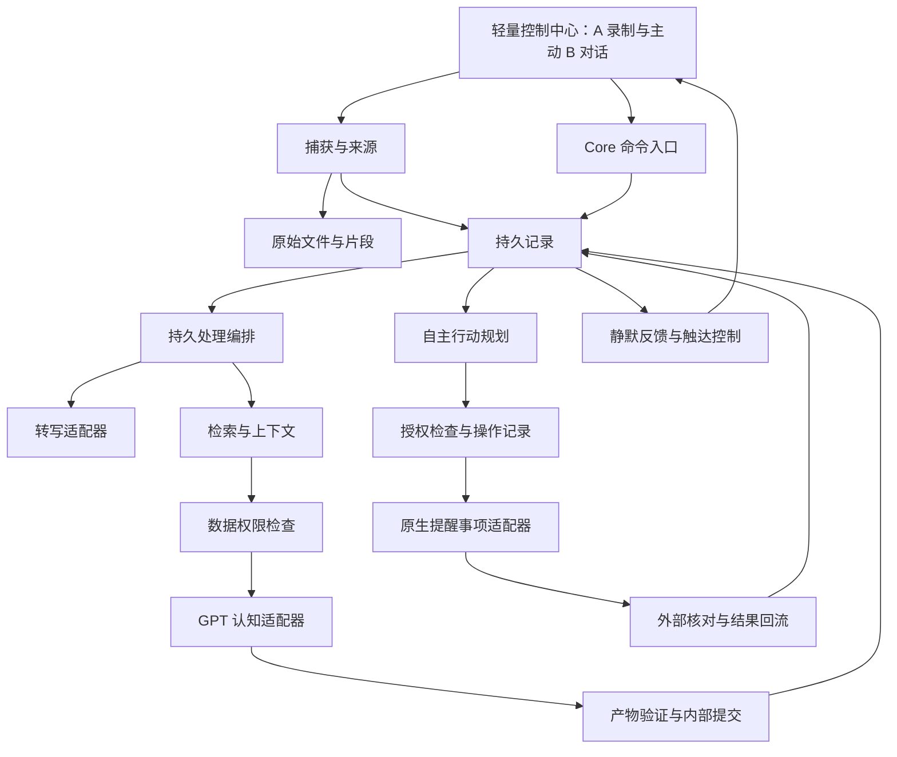

# VoiceOS 系统架构 v0.1

日期：2026-10-10。状态：可审查工程草稿；第三阶段验证继续进行，技术栈与部署方案未冻结，已实现 M1 输入子集，完整架构尚未实现。

依据：[愿景 v1.1](../VoiceOS：产品愿景与概念设计文档%20v1.1/VoiceOS_产品愿景与概念设计文档_v1.1.md)、[PRD](../product/prd.md)。配套：[数据模型](data-model.md)、[状态机与恢复](state-machines.md)、[架构审查与需求映射](review.md)、[ADR 索引](../adr/README.md)。

## 1. 推荐结构与证据范围

首版推荐一个长期运行的 Mac 应用承载原生录制、EventKit 和轻量控制中心；可复用 Core 与平台适配器分成代码模块，先不分成独立服务。关闭阅读窗口不终止处理；用户真正退出应用或 Mac 睡眠后，持久任务在下次启动/唤醒恢复。无需购买常驻服务器，也不承诺退出应用后仍计算。

Core 候选使用可复用 Swift package，UI 候选 SwiftUI，结构化状态候选 SQLite，音视频放独立文件；详见 ADR-001/002。这是当前 Mac 工程路径，不承诺最低系统版本。Python 探针不是已有生产后端，原生测试应用不是产品骨架。

当前证据：本地中文单个合成转写、WAV/M4A、SQLite 合成中断与迁移、一个提醒事项的真实创建/编辑/完成/重开、一次 GPT 结构化生成。真实录制/睡眠、英语、语义检索、并发、故障同步、上传拦截及质量门槛未通过。网关出现超时/503；不把模型标签或 JSON 合法当作认知质量证明。[实测报告](../research/api-reminders-validation-2026-10-10.md)、[可靠性报告](../research/reliability-validation-2026-10-10.md)。

## 2. 模块边界

箭头表示逻辑责任，不要求进程间网络通信。所有 GPT/云端转写发送都经过权限检查；图中转写适配器若选择云端，也必须调用同一发送检查。模型仅提供理解和计划提案；确定性的身份、持久化、权限、恢复与执行由 Core 负责，不依赖复杂 Agent 提示维持。

| 模块 | 负责 | 输入与输出 | 不承担的责任 |
|---|---|---|---|
| Capture / Assets | 用户控制录制、导入原件、封存与源轨信息 | 原件/片段 → Source、Asset、保存结果 | 不推断节目音轨就是用户思想 |
| Orchestrator | 处理步骤、条件等待、租约、重试与恢复 | ProcessingJob → 阶段产物引用 | 不因超时猜测外部未创建 |
| SpeechPort | 可替换本地/云端转写、语言能力查询 | 来源版本 → 忠实 Transcript 与时间范围 | 不改写原始文件；不冒充认知提取 |
| Memory / Context | 查找授权历史、当前版本、证据和有效关联 | 查询 → ContextBundle 与出处 | 不把所有旧资料或关键词同名项塞进上下文 |
| CognitivePort | GPT 提取、关联建议、基本 B 对话和英语表达反馈 | 授权上下文 → ProposedArtifacts | 不直接写数据库或调用提醒事项 |
| Validation / Revision | 结构/归属/引用校验、修订与影响冻结 | 提案或纠错 → 可提交版本/待核对原因 | 不把结构校验当作语义正确证明 |
| ActionPlanner | Goal/Project/Task/Opportunity，少量下一步与弹性排序 | 用户意图与有效依据 → PlanRevision | 不把模糊愿望全部变成正式任务 |
| Executor / Sync | 持续授权下自主普通操作，操作身份、回读、冲突 | Operation → Observation/同步结果 | 不要求逐条审批普通动作；不越过重要执行边界 |
| Feedback | 静默关联、可忽略回顾、通知开关/预算/去重 | 有效关系与任务事实 → FeedbackItem | 不自动进入 B，不给未回复制造债务 |
| ControlCenter | 保存/处理状态、阅读回溯、候选任务、B、纠错与数据控制 | 查询视图 + 用户命令 | 不成为历史唯一存储，也不承担后台任务生命周期 |

核心模块采用显式接口与数据版本，无需首版引入 Agent 框架、多 Agent 或工作流服务。AI 在产品授权范围内自主规划，提示只说明任务、必要归属和结果契约；运行时检查不堆进 AGENTS.md。

## 3. 完整闭环的具体处理

### 3.1 录制/导入到理解与行动

1. 接收用户开始/导入命令，先持久化 Source 身份和保存意图。录制中写可识别片段，保留轨道身份；导入先复制到自有资产目录，不只保存原路径。
2. 停止或复制结束后校验长度/摘要与容器，封存原件；数据库登记 saved 并在同一事务创建转写 job。封存前不显示“已保存”。片段恢复见状态机，不靠 GPT 修复损坏文件。
3. 转写按语言与设备能力选择适配器，时间偏移映射回原件；清理稿独立于忠实逐字稿。同一 job 重试不产生重复版本。
4. 检索与当前表达相关的历史，构造带来源/版本/有效性和处理限制的上下文。仅本地资料被排除于云端请求，不能先生成摘要绕过限制。
5. GPT 输出提案；校验引用存在、范围合法、版本仍当前、认知归属与证据字段独立。明确用户表达自动暂存；AI 新推论为候选；严重歧义待核对。结构错误可失败，语义错误通过回归和用户纠错持续发现。
6. 内部提交事务同时写产物、派生依赖和后续工作记录。自主规划从明确意图激活少量任务；机会池不外写。权限满足的普通动作生成 Operation，不逐条审批。
7. Executor 在调用前再次检查 scope、版本、授权、实际写出字段的来源限制和冻结状态，再持久化 sending。仅本地内容不能通过提醒事项标题/备注或其他适配器绕过限制。外部保存返回仍需回读 ID/字段；未知结果先核对。结果静默呈现，AI 故障不影响用户找回原件。

### 3.2 完成回流与新的表达

1. 启动、唤醒、相关变更通知或用户刷新时，重新获取授权清单里的关联项。通知只作查询触发，不当作某任务已完成的证据。
2. Observation 记录外部值、时间与读取结果；唯一核对后的完成更新 Task，生成任务结果事实并链接原意图。离线保留最后观测时间。
3. 勾选完成不改变 Claim 的认可/证据状态。普通事务到此即可；学习任务提供可跳过的结果入口，不强制回顾。
4. 后续用户表达产生新 ThoughtEvent 和独立来源，经检索找到原 Claim/Task/Outcome。GPT 建议支持、限定、修正或延续关系，保存出处和可信边界。
5. Revision 区分用户真实认知演进、证据更新与系统纠错。原始猜想仍可回溯，已失效版本退出可信当前检索。此链才覆盖 PRD 案例 A。

### 3.3 模式 B 与英语

只有用户显式命令才能创建 active Conversation；通知点击可以打开记录，不自动开始对话。推荐首版文字对话承载基本 B，按回合语音作为 H03 候选，不承诺全双工。每次发言有 speaker、source 与 event 关联；用户新表达和 AI 建议仍经过统一理解/归属流程，结束 B 不代表认可所有回答。

英文原文、修正稿与 ExpressionFeedback 分开存；比较相似表达错误时引用两次片段。当前没有发音评估后端，首版不从文字输出发音分数。用户的本地英语模型资源及真实样本表现仍需验证，不能因本地缺少英语而删掉案例 C。

## 4. 首版接口契约草案

接口名是语义契约，尚未生成 Swift 类型或 API 路由。每个变更命令带 `command_id`、预期对象版本、发起者；执行结果带可见状态及原因，不用自由文本驱动状态机。

| 接口 | 关键请求 | 成功/等待/失败输出 | 约束 |
|---|---|---|---|
| Capture.start / finish / import | capture_id、输入类型、轨身份、时间/权限 | Source/Asset ID、保存范围、故障原因 | finish 返回 saved 前满足封存条件；import 不执行文件内指令 |
| Speech.transcribe | source_version、asset_id、语言、分段偏移、有效限制 | TranscriptVersion、片段、语言/不确定性 | 不足权限或缺资源返回等待条件，不暗中换云端 |
| Memory.query | 目的、搜索词/事件、权限版本、当前知识 epoch | 候选版本与片段、关联依据、截断说明 | 读时过滤删除/冻结/过期版本；不依赖索引清理已完成 |
| Context.prepare / send | 来源版本集合、目标服务、数据类别 | 实际发送包、来源清单、排除原因 | 发送前重验 epoch/授权，模型不能自行追加未授权历史 |
| Cognitive.propose | ContextBundle、提示/模型/契约版本 | ProposedArtifacts、usage、调用状态 | 超时单独记录费用/结果未知；不直接执行提案 |
| Artifacts.commit | job/stage 身份、输入版本、epoch、验证后提案 | 新版本 ID 或 stale/conflict | 单事务、CAS、唯一产物键；过时输出不覆盖纠错 |
| Action.apply | 计划版本、目标任务、授权快照、字段变更 | Operation ID、blocked/queued | P01 持续授权足够时自主；重要动作凭具体授权 |
| Reminders.observe / perform | 明确 scope、关联 ID/标记、预期外部快照、操作 ID | Observation 或发送/核对状态 | scope 不可为空；零匹配不自动重建，多匹配不随便挑一个 |
| Revision.correct | 对象版本、用户更正/依据、原因分类 | Revision、冻结根、影响清单 | 先封锁可信传播，再后台扫描影响；高影响补偿单独授权 |
| Data.export / restore / delete | 格式/资产模式或明确删除范围 | manifest、预检报告、删除范围/外部边界 | 恢复默认不执行外部写入；删除不能被历史修订绕过 |

这些接口在同一进程调用即可。未来分进程或云端化时再增加认证、传输与兼容版本协议，首版不先搭内部 HTTP 服务。

## 5. 检索与上下文

初始候选为结构/日期/主题/关键词检索，加可替换语义索引；中文检索、正负关联和长历史召回需要 H07 实测。索引是可重建投影，不是个人历史的唯一副本；向云端做 embedding 也属于发送，遵守同一来源限制。

上下文优先包含当前表达、显式锚定的旧记录、相关目标/任务结果以及有证据的候选历史；GPT 获得原文片段及版本引用。token 预算由模型/服务配置提供，不把固定 Top-K 当作“充分历史”。不足时记录遗漏与原因，可在预算内扩大检索；仍不足则说明限制，不能捏造确定关联。

用户确认与证据状态、外部归属、AI 候选和有效性必须随引用一起发送。资料中的操作指令只作为内容；权限与执行策略来自应用命令/授权。源对象冻结或被删后，已有 ContextBundle 立即失效，发送与内部提交均重验。

## 6. 生命周期、部署与迁移

- 首版一个进程拥有原生权限和数据库写入；后台含有持久 jobs，而不是只存在于内存的 UI Task。系统不保证应用退出后仍运行。将来拆独立引擎进程须重新验证权限身份及可靠 IPC。
- 唤醒先恢复文件、租约与未知操作，再启动可重试工作；不重放 sending 操作。取消/撤销阻止尚未发送操作，已发出的效果进入核对，不能承诺回滚外部事实。
- UI 显示保存、理解、同步三个维度；窗口关闭不取消已保存资料。模式 A 不插语音询问，恢复说明在状态入口呈现。
- 当前测试 .env 是探针配置。正式产品凭据存系统凭据库的方案待验证；私有运行目录与公开日志分开，不沿用文档目录保存秘密。
- Core、实体身份和公开导出格式不依赖 UI/思源/提醒事项 ID。B → C 可先替换页面/适配器；跨设备同步另做 ADR，不把数据库文件共享当同步。

## 7. 审查门槛

本稿能解释机制，不证明它已实现。进入实施基线前，按[审查表](review.md)补足录制边界、模型与检索质量、稳定应用身份、恢复/权限/冲突、备份与删除的实测。无法满足 PRD 时提出证据和产品影响，不悄悄删掉基础 B、英语或完整闭环。

2026-10-10 开发切片增量：schema 10/逻辑包 9 已实现显式用户文字 origin=user/speaker=user、保留原文资产与文字版本；user_tentative 归属和 nullable action 提案与行动同事务提交，auto_send 默认 0，普通明确提取任务经本机连接/来源权限核对有限激活。外部完成仍独立反馈，不认可观点。恢复原提取/行动关系、旧格式 1–8 和旧 schema 9 已核对；完整目标、语音身份与长期闭环未完成。实际字段/边界见[表达行动记录](../engineering/m3-expression-actions.md)与[ADR-007](../adr/007-expression-action-extraction.md)。
