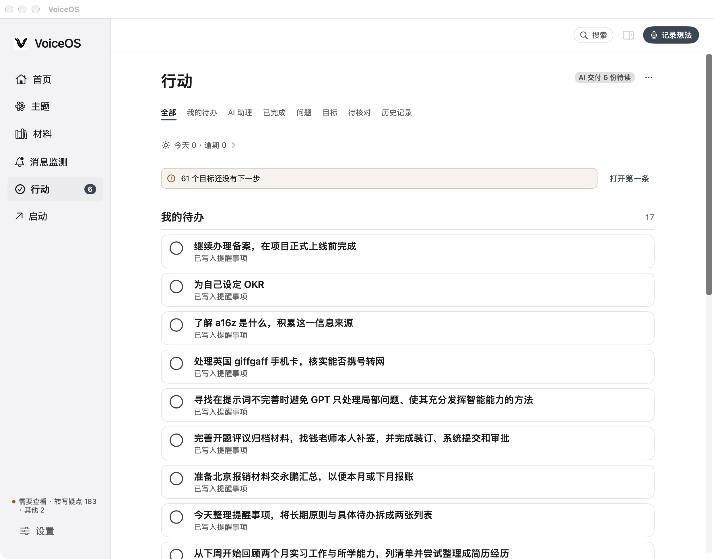
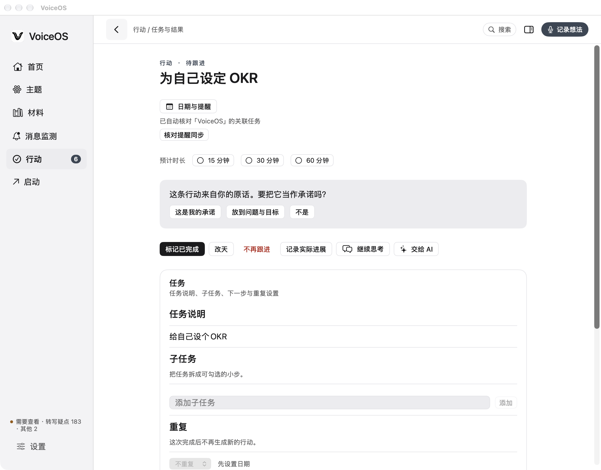

# VoiceOS 产品战略与体验审计

2026 年 11 月 22 日 · 产品决策稿 · macOS 日常资料库

**我建议把 VoiceOS 的日常承诺定为「先把想法说下来，过后能带着原话继续」。** 对只想留存的想法，可靠保存就是一次成功。对值得推进的事，用户再次打开时，应该能认出当时想解决什么、后来做过什么、现在接着做什么。技术访谈适合检验这条链的深度，随手口述适合检验它是否足够轻。两种场景应共用一套体验。

这回最能说明问题的是两次点击。一次，我从首页一条真实的结果回到了对应的已完成任务，找到了当初的原话，还能再口述一句进展。另一次，我点开一条显示「已写入提醒事项」的待办，详情却问「要把它当作承诺吗？」。前者说明 VoiceOS 已经能替人记住一件事的来龙去脉；后者说明用户仍得替系统解释它自己的判断。

## 一　当前产品究竟是什么

VoiceOS 已是一款可以工作的个人研究与行动工作台。它能采集完整表达、整理观点、保留出处、组织跨材料主题、连接 Apple 提醒事项、产出 AI 文稿和 Agent 交接草稿，也能接回真实进展。它目前最擅长**查一件已经留下的事**。用户知道材料名、任务名或主题时，常能一路找到原话；只带着「我还想接着弄那件事」进来时，需要先替自己的意图选一个模块。

| 实际入口 | 今天能做什么 | 与其他入口的关系 |
|---|---|---|
| 全局「记录想法」、菜单栏、快捷键 | 口述、文字、导入；区分个人表达和外部资料。完整个人音轨可本地转写，再按许可整理 | 文字保存后能打开本次材料；完整录音流程的「查看任务与后续」进入全局行动页 |
| 首页、材料 | 首页按天混排表达和实际反馈，选中后有阅读器；材料库另有阅读状态、归档、原文、回听、纠错和相关行动 | 同一段话可读两次。首页适于快速辨认，材料详情适于核对依据；两者的分工在主流程里不够清楚 |
| 主题、搜索、讨论 | 按主题跨材料阅读认识、问题、行动和结果；搜索可跳转，讨论可沿当前对象继续 | 有积累知识的实质价值，适合从问题或出处进入。主题详情内还有四个分区 |
| 行动、每周回顾 | 管待办、问题、目标、AI 交付和历史；可安排提醒、记录进展、重访结果 | 已有「真实结果 → 对应任务」的可用通路。侧栏「行动」数字实际指待读 AI 交付 |
| 启动、AI 助理 | 启动支持回答、澄清、自己动手、交给 Agent 或仅记录；交接稿可编辑、确认、复制、续记。AI 助理则能承接调研、比较、起草并保存交付 | 前者准备给外部执行者的材料，后者会在应用内做事。「复制」「确认」「执行」「得到结果」有不同含义 |
| 消息监测、处理情况、设置 | 监测有日报、历史、来源和独立的事项处理；处理情况可定位材料疑点或失败；设置管理许可、模型、连接和维护 | 截至走查，当天监测报告已生成，微信推送未配置。监测事项的「标记完成」更新监测记录，本身没有建立个人承诺 |

**能力边界。** 上表中页面和已有内容做了实机走查，采集与后台链路还核对了代码。实时全双工语音、可替用户跨应用自主执行、完整跨设备接续仍属愿景。现有交接包和手记步骤已经实现，本轮没有看到 Codex 接单、执行和自动回传的闭环。旧「思考全景」已从主干和首页移除；每周回顾里的「认知地图」仍在。README 的导航摘要只列四项，当天实机主导航是六项。历史待办里仍有的全景任务不计入现状。[主导航](../../../../Sources/VoiceOSApp/WorkspaceView.swift#L745) · [全景退役记录](../../../../work/STATUS.md#L1036) · [愿景与首版边界](../../../VoiceOS：产品愿景与概念设计文档%20v1.1/VoiceOS_产品愿景与概念设计文档_v1.1.md#L105)

## 二　三条用户旅程揭示的根因

**1．想到一句话。** 从已有首页点「记录想法」，再点「开始口述并自动整理」，共两次选择；熟练用户可用 ⌥⌘D 直接开始。主按钮确实醒目。进入记录页后，最大片区域属于标题、正文和文字保存，口述则和完整整理绑定。源码确认，主口述入口在本地转写或文本模型未配置时会被禁用。首次引导写着「在本机整理」，设置和实际链路则区分本地转写与获许可的云端理解。**获得第一份可靠原话，承担了配置后续智能处理的门槛。** 本轮走查的是配置齐全的日常库，未用新账号测首用流失。[记录页实拍](03-记录想法.png) · [口述前置条件](../../../../Sources/VoiceOSApp/VoiceOSApp.swift#L506) · [首次引导](../../../../Sources/VoiceOSApp/Onboarding.swift#L13)

**2．继续一件已经说过的事。** 一段 39 秒的充电器学习口述可以在首页看摘要、回听，也能打开完整材料。沿当前语境查看交接，实际走了四次选择：选中表达 → 打开材料 → 更多 → 从这里启动。最后看到了这段表达已有的交接草稿。侧栏「启动」是另一条短路，但要求用户先知道功能名字并认对原材料。草稿能清楚列出目标、已知和待核实信息，这是优势；同一份充电器学习草稿也要求 Agent 先检查仓库和文件。这句是通用模板固定加入的，说明交接质量还有一个与布局无关的问题。[首页阅读](09-首页读一条表达.png) · [完整材料](10-同一表达的材料详情.png) · [菜单](17-材料更多菜单.png) · [现成交接稿](18-从同一材料进入交接.png) · [交接模版](../../../../Sources/VoiceOSCore/TaskInitiation.swift#L218)

**3．知道现在该处理什么。** 同一次走查，「行动」徽标是 6，展开是 6 份 AI 交付待读；当日待办 0、逾期 0，下面却高亮 61 个没有下一步的目标，并给出「打开第一条」。首页「每周回顾 · 84」指待补结果；侧栏另有 183 条转写疑点，处理页同时显示当前没有正在执行的处理。每个数字都能找到解释，它们的单位、后果和紧急度却不同。尤其是那条已写入提醒的任务，源码显示，近期抽取、仍开放且尚无澄清记录等条件就足以显示承诺问题；这个条件没有检查是否已经关联提醒。实测证实同屏的语义冲突，**不足以证明当初写入的提醒有错**。[行动](05-行动.png) · [承诺询问](06-任务详情.png) · [每周回顾](11-每周回顾.png) · [处理情况](13-处理情况.png) · [显示条件](../../../../Sources/VoiceOSApp/WorkspaceActivityViews.swift#L422)

三条路径指向同一个根因：**表达一经处理，产品就逐渐按产物和处理队列组织体验。** 首页展示最近发生的事，材料承担来源与阅读，主题组织认识，行动管理多种状态，启动另存草稿。每一页单独看都有理由，跨页后却需要用户记住「我之前在哪一套分类里处理它」。过往演进记录也显示，已有多轮字号、卡片、原文导航与性能改进；这些成果值得保留，现有证据仍把优先级指向页面之间的关系。[改善历史](../../../../work/PROGRESS.md)

| 审计维度 | 判断 |
|---|---|
| 定位与功能价值 | 能同时支持安静记录和主动推进；当前两个时刻之间缺少公认的主路径。若把每个想法都推向行动，会损失口述的自由和知识积累的价值 |
| 信息架构 | 六个并列入口混用了时间、知识分类、对象、来源和动作。最贵的成本是选错后重找同一件事，并非数字「六」本身 |
| 核心旅程 | 真实反馈能回到任务，是可复用的正面样本。完整录音整理后的入口却去全局行动，把辨认「哪些是刚才的」交还给用户 |
| 交互与视觉 | 主要按钮、留白、卡片和标题大体可读。视觉上最强的警示有时对应最庞大的历史集合，视觉轻重与用户责任错位 |
| 一致性与可访问性 | 已连提醒仍问是否承诺；监测完成、任务完成和 AI 交付完成分别指不同事实。部分图标和数字有辅助说明及键盘入口，但视力正常用户也得靠悬停或切页解释。未进行完整键盘或 VoiceOver 验收 |

## 三　现在最值得作出的三个决定

### 第一优先　让一次表达有一个可以回来的地方

**选择。** 以一次表达及其后续为日常阅读单位。录完、文字保存或访谈整理完成都回到这次内容。首屏先回答「保存了什么」「理解出了什么」「跟我有什么关系」。只有确实产生了待办、待核对判断或可用交付时，才在相应位置给出下一步。纯想法可以安静结束。首页负责开始记录和接回最近的一件事，资料库负责找旧内容；沿用已有材料详情、原话定位和结果链接。

**为什么先做。** 两次进入阅读器、录音结束去全局行动、从记录页还要再选口述，影响几乎每类使用者。即使模型全部答对，用户仍会遇到这些分岔。模型暂不可用时也应允许在麦克风许可范围内先留存原音，明确显示后续能否整理。

**代价与反证。** 改造成本中等，主要是录制状态、处理完成落点及既有深链。时间线可能就是熟练用户最好的入口，所以保留日期浏览、快捷键与阅读位置。如果真实使用多数是定向找旧资料，首页要给搜索足够位置。继续按现状添加更多结果类型，只会增加用户为同一表达找入口的次数。

**验证。** 观察短灵感与完整技术访谈两类真实使用。前者允许保存即离开；后者整理后应能在本次表达找到观点、任务、相应原话和后来的进展。检验用户隔天能否接回同一件事，无需记得它被分到了哪一页。

### 第二优先　让用户知道哪些事真的需要自己决定

**选择。** 把「我的承诺」「AI 建议或待判断」「系统处理状态」说清楚。明确表达且已有相应许可的待办继续自动流转；含糊的意图附原话，等它影响行动时再澄清；对已同步的任务提供易懂的更正或撤回。完成一件事、AI 交付一份文字和人报告了实际结果，分别记录。首页只突出现在有后果、需要本人判断的事，其他疑点和历史缺口可按材料、回顾或诊断查阅。

**为什么排第二。** 看不懂任何一个数字都可以学，会反复怀疑「它到底替我承诺了什么」却会削弱整个系统的可信度。61、84、183 是这个库此刻的真实数量；其中有多少有用、多少属于旧数据或误提取，还需看原话，不能由数量倒推。

**代价与反证。** 成本中高，涉及旧任务、澄清记录和真实 Apple 提醒的不同历史。历史不明就保留「依据待核对」，已有同步记录不能被倒推成一次人工确认，也不能为了整齐而改动外部清单。压低提醒显著性有漏掉期限的风险，所以验证要专门检查临近截止及会改变行动含义的疑点。维持现状的风险是用户学会忽略所有提示，包括真正紧急的那一项。

**验证。** 抽取同一批表达，覆盖明确承诺、模糊愿望、否定和外部作者建议。逐项对照原话、界面与提醒实际状态；关键任务不能漏，愿望不能凭空变成承诺。请用户在打开首页后说出「今天需要我决定什么」，并解释跳过会产生什么后果。

### 第三优先　让启动服务于手头这件事，交接的终点定义为「可以交给别人」

**选择。** 在有依据的表达或任务旁提供「帮我开始」。简单问题给回答；需要自己做的，给出可执行的第一步；明确要交接的，才生成交接稿。稿件保留原话、目标、约束、待核实事实和验收方式，允许编辑复制及回来记结果。应用内能做的调研、比较和起草标清「由 VoiceOS 处理」；交接给 Codex 等外部工具标清「准备好／已复制／结果已回填」。熟练用户仍可直接打开最近草稿。

**为什么排第三。** 这项能力已经有真实产物，路径和产物适用性比增加执行器更值得投入。普通记录可接住个人长文，启动路径却会拒绝超过 4,000 字的输入。长访谈应能从选中的意图出发并保留可核对的全文依据。另有一个应优先纠正的许可问题：从「仅本机」材料原样带入并允许生成时，当前实现会在请求前持久化修改整份来源的云端许可。页面只讲这次发送哪段原话，用户很难预料对原材料的长期影响。本轮只读核对了这条代码路径。[启动界面](../../../../Sources/VoiceOSApp/TaskInitiationView.swift#L134) · [生成及授权逻辑](../../../../Sources/VoiceOSApp/VoiceOSApp.swift#L603) · [材料级许可写入](../../../../Sources/VoiceOSCore/ModelPort.swift#L62)

**代价与反证。** 成本中等，难点是引用哪一段、哪个版本，以及单次授权的边界。有人可能频繁以一张空白交接稿开始工作，届时可保留直达入口。继续扩充独立「启动」页，会让记录、讨论、内置代办和外部交接进一步争夺同一句输入。

**验证。** 给实际执行者一份真实交接稿，观察它能否据此开始、是否要重问已经说过的背景。另一条普通知识问题应能在一次回答后结束。测试长访谈的单个意图、仅本地材料的单次使用、复制后未执行、执行后回填四种情况，核对源授权、任务事实及回流位置。

## 四　结构草案与功能取舍

| 现状 | 建议的用户入口 | 用户来这里做什么 |
|---|---|---|
| 首页时间线及其独立长阅读器 | **现在** | 开始口述或输入；恢复最近的一件事；必要时看到一项值得本人判断的例外。保留按日期浏览 |
| 材料与主题两套一级浏览 | **资料库**，内含「按材料」「按主题」，保留全局搜索 | 记得原话就找材料，记得问题就找主题；两种检索都能抵达同一出处 |
| 行动的八种并列筛选 | **行动**，默认我的承诺；待判断和历史按需进入 | 知道要做什么、如何提醒、后来做到了什么。问题与长期目标继续存在，能挂具体下一步 |
| 独立启动、任务内 AI 助理、讨论侧栏 | 在当前表达、任务或问题上继续 | 回答、进一步讨论、准备交接或取得内置交付；结果就地可找 |
| 消息监测、侧栏处理提醒、设置 | 可直达的「消息报告」；后台处理与连接归入辅助入口 | 查看外部信号和诊断。值得跟进的外部事项由用户接纳，再进入行动，保留原报告与期限 |

**保留**完整原音原话、归属及纠错、回听与证据、时间线、跨材料主题、全局快捷捕获、Apple 提醒和真实反馈。**改造**录制与整理的耦合、结果页、承诺状态和交接稿。**合并或移除**重复长阅读面、默认并列的启动入口和混合职责的数量角标；按天读、译文、英语练习等低频能力保留在相应内容内。**延期**全景重建、新图谱、新监测渠道、通用执行 Agent、实时双工和跨设备扩张。监测已有真实日报，降低默认导航地位的同时保留直达；不因低频就删除用户已经依赖的服务。

建议的主流程：

~~~text
说下或导入 → 原话已保存 → 这一次的理解与出处
                            ├─ 只想记住 → 留存，可在材料或主题里找回
                            ├─ 还想弄懂 → 继续讨论，关联或修正已有认识
                            ├─ 明确要做 → 行动与提醒 → 记录真实进展 ─┐
                            └─ 需要协助 → 回答、第一步或交接稿 → 结果 ┤
                                           回到原表达、任务与相关主题 ←┘
~~~

## 五　分阶段路线及验收

以下是拟议的产品验收条件，尚未测得改版后的成绩。先用当前版跑同一组任务，记录入口选择、回退、错认及是否完成，避免仅凭新版看上去更简洁就通过。

| 阶段与目标 | 页面、改动及用户感受 | 本阶段范围外 | 验收 |
|---|---|---|---|
| 1．说完就能放下，回来仍接得上 | 记录、首页、录音完成页、材料详情。原音先落地，整理结果回到同一表达，首页提供记录与接续 | 调整自动建任务规则、迁移全部旧数据、制作新首页图表 | 用短灵感、纯记录、长访谈、文本模型不可用四例实测。均能确认原内容是否已存；整理完成直接落在本次内容；隔日能在两次选择内从首页恢复最近表达 |
| 2．行动与提示值得信任 | 行动、提醒、处理情况、每周回顾。让承诺、建议、阻塞和可选反馈各有去处、有原话可查 | 新通知渠道、大批重写旧提醒、要求所有结果都补填 | 从真实原话抽样并故意加入否定、模糊日期、外部资料和已同步旧任务。关键明确承诺零漏项，零无依据的新提醒；用户能分清已完成、已有交付和已有实际结果；没有紧急事项时可放心离开 |
| 3．想法可交接，知识能复用 | 表达与任务详情、启动草稿、主题、消息报告。就地交接或记下第一步，真实结果回接，主题能找回后来的修正 | 外部 Agent 控制台、模拟执行回执、通用项目管理 | 一次技术访谈意图能生成可交接材料，执行者无需重问已有背景；一个单纯问题止于回答；一次跨日反馈能从旧观点找到新依据。仅本地来源持续许可可核对，未回填时不显示已执行 |

最终用一周自然使用判断方向：记录几次确实在第二天继续了原来的想法，几次因为找不到出口改去别处，几次提醒被认为是系统替自己选的。保留一例完整访谈作深度检查。**主动留下又主动回来，才比生成了多少条待办、主题或交接稿更接近产品价值。**

## 六　需要所有者拍板的一件事

**未来四周，若只能把一种回访场景做到让你形成习惯，你选「把上次说过的事继续下去」，还是「每天先看今天必须采取的行动」？** 我推荐前者，并让真正临期、需要你决定的事项能打断它。前者能同时容纳纯思考、访谈和交接，也是相比现有提醒工具更有辨识度的价值。如果你选后者，首页主次、监测报告进入首页的条件、第一阶段的验收指标都应随之调整。其余入口命名和布局可以交给真实使用来验证。

---

### 证据索引与限制

审计版本为本地 main 的 a670ace，与当时本地 origin/main 指针一致；操作对象是仓库 dist 中已经运行的原生应用。以下编号是本轮采集的窗口截图。数据量是一次日常库快照，不能据此推断总体准确率、各模块使用频率或真实用户留存。

| 实机走查 | 检查点与证据 |
|---|---|
| 1．在已有库打开工作区 | 当时窗口停在[材料](01-打开工作区.png)，主动切到[首页](02-首页.png)后恢复已有选择。这次观测不能代表首次启动 |
| 2．准备捕获 | [记录页](03-记录想法.png)可见语音、导入和文字入口，数据归属和许可可展开 |
| 3．启动入口 | [独立进入启动](04-启动.png)能看到真实草稿，支持带入材料 |
| 4．检查承诺 | [行动列表](05-行动.png) → [任务详情](06-任务详情.png)，已写提醒与承诺询问同屏 |
| 5．找长期认识 | [主题列表](07-主题.png) → [主题内阅读](08-主题内阅读.png)，能看到跨材料组织、原话依据和四个分区 |
| 6．读同一次表达 | [首页摘要](09-首页读一条表达.png) → [材料详情](10-同一表达的材料详情.png)，深入资料仍能看要点和回听 |
| 7．决定是否回顾 | [每周回顾](11-每周回顾.png)说明了待补结果、目标与待确认各自的数量 |
| 8．看外部消息和后台状态 | [日报](12-消息监测.png)、[处理情况](13-处理情况.png)、[设置](14-设置.png)分别展示业务结果、待核对材料和连接状态 |
| 9．从结果继续 | [回到已完成任务](15-从实际结果回到任务.png) → [展开记录结果](16-记录结果入口.png)，有文字和口述入口 |
| 10．从原话准备交接 | [材料更多菜单](17-材料更多菜单.png) → [同一材料的已有草稿](18-从同一材料进入交接.png)，实际走通上下文入口 |

本轮未修改项目代码，未新增或编辑用户的材料、任务、交接稿及反馈内容。为保持只读，没有新增录音、提交云端理解、改动 Apple 提醒、触发消息推送或委托外部 Agent；这些环节的实现与历史产物分别核对，端到端成功率、模型提取质量、跨日习惯和辅助技术体验仍需真实试用。截图只存于本机报告目录。
