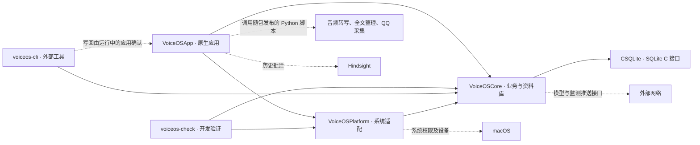

# VoiceOS 架构现状与任务池

基线为日常版源码 `964c164`，依赖以 [Package.swift](../../../Package.swift) 为准。运行时职责以当前实现和正常调用入口为准。该文件随架构治理任务更新。

## 依赖方向

SwiftPM 的 targets 无模块循环。命令行到应用的写回走 URL 协议和回读确认，无编译期依赖。Core 已承载领域规则，同时直接依赖 SQLite、HTTP、CryptoKit 和局部 NaturalLanguage。App 中仍有外部服务接线、部分运行状态与存储读写，编译图不能证明业务边界已清晰。

## 状态所有权

| 概念 | 当前所有者与正常入口 | 应保留的契约 |
| --- | --- | --- |
| 材料、逐字稿、笔记、观点、行动、讨论、主题 | `VoiceOSStore` actor 及其领域扩展写 SQLite。原件在资料库 `assets/`，搜索和工作区读取由 `SearchIndex`、`WorkspaceSnapshot` 等投影提供。 | 原件身份、当前修订、来源归属、用户编辑、历史记录，以及归档或回收状态。 |
| 任务与实际提醒 | 行动状态及提醒意图、许可、回执归 SQLite。Platform 的 EventKit 适配读写 Apple 提醒事项，系统侧状态从回读确认。 | 本地任务与外部提醒分别核实，外部冲突、未知写入结果和反馈历史可追溯。 |
| 应用运行与窗口状态 | `ControlCenter` 启动资料库并协调后台工作，缓存快照并发布给 SwiftUI。 `WorkspaceView` 管页面选择、阅读位置和侧栏。录音收件箱和自动监测另有运行对象。 | 独立资料库窗口有自己的运行状态；列表、详情、搜索、通知和 CLI 跳转同一业务对象。 |
| 个人文本模型配置 | Platform 的 `TextModelConfiguration` 和 `TextModelKeychain` 持久化应用配置及密钥。`LocalTextModel` 还接受外部文件给开发工具和既有用户迁移，`ControlCenter` 决定启动优先级。 | 清除后不回退；损坏与未配置可区分；已有文件格式和钥匙串名称可继续使用。 |
| 转写与整理 | Platform 负责本机录音、Qwen 与处理脚本进程。Core 持久化任务、阶段和有效性；脚本也保存可续跑缓存。 | 转写断点、完整校正稿、全文任务提取及模型阶段回执。 |
| 历史批注与记忆 | App 的 `NoteHistoryMemory` 适配 Hindsight，按库保存同步配置和批注文件，SwiftUI 用段落定位呈现。 | 笔记正文与历史批注独立。此前启用试点的库能继续读取已有配置。 |
| 消息监测 | Core 的 `MessageMonitorRunner` 等处理工作与回执，Platform 运行网页及 QQ 采集，App 的 `MonitorCenter` 管启动、配置、凭据与状态展示。 | 来源各自保有读取和投递进度；网络错误及投递结果可区分。 |
| 备份和跨库读取 | `DatabaseBackup` 管本机 SQLite 备份及原件检查，`PortablePackage` 管独立格式的导出与恢复，`ReadOnlyLibrary` 提供 CLI 的一致快照。 | 导出版本独立于 SQLite schema；只读 CLI 能在应用持有互斥锁时读取，写回仍由应用执行。 |
| UI 样式 | `WorkspaceTheme` 提供颜色，`WorkspaceDesign` 提供通用布局和控件，具体页面持有交互语义。 | 已认可的阅读排版、视觉层级、批注、默认页和快捷操作。 |

## 技术方案与偏离

| 编号 | 发现与证据 | 处理方向 |
| --- | --- | --- |
| A01 · 已验证 | `Database`、`ReadOnlyLibrary`、`DatabaseBackup` 重复直接使用 SQLite C API。写端、读端和迁移测试分别固定当前 schema。 | 迁移到一个 SQLite 连接实现和一个当前 schema 来源，保留连接模式、备份策略和历史迁移。 |
| A02 · 已迁移 | Responses 各领域端口通过构建 `ResponsesModelPort` 复用校验，随后各自构造相同的 HTTP 地址、POST、鉴权和 JSON 请求。 | 让所有端口使用同一个 Responses 请求实现。保留已有超时、请求字节生成方式、传输和持久化失败分类。 |
| A03 · 已验证 | `Database.configure()` 用连续的 `PRAGMA user_version` 查询判断迁移来源，当前库每次打开也遍历条件。当前 schema 写在上限及最后一条历史迁移。 | 把迁移身份和运行顺序集中起来。保留所有历史迁移事务、外键切换和跨版本恢复契约。 |
| A04 · 已统一提醒快照及二级发布 | `ControlCenter` 的全量/按段刷新同时读取 `WorkspaceSnapshot` 和若干独立数据，再分散更新可观察状态。`WorkspaceView` 还持有选中态与导航。 | 先追踪每段读写者，再按刷新数据的所有权归一，保留在用的性能约束与异步导航保护。避免仅切割文件。 |
| A05 · 已移除两个旧视图 | `WorkspaceRow`、`WorkspaceListRow` 以及部分页面自制行共存。 | 逐条核对 hover、选择、焦点、菜单和图标变体，统一语义相同的实现，用两条真实入口验证。 |
| A06 · 已统一资料库路径和模型套件 | `voiceos.sqlite`、应用数据根目录默认值、模型默认 effort 分散在应用、工具、备份和脚本。 | 先处理同一语言内的权威来源。既有启动环境变量和参数是外部契约，应保留。 |
| A07 · 已统一模型请求退避 | 模型同时使用非流式 HTTP、SSE、Python 全文整理及 Hindsight；多处重复错误摘要与重试逻辑。 | 逐一识别同协议同语义的重复。保留传输差异、模型结果未知和可重试的区别，保持凭据和个人正文不进入诊断。 |
| A08 | Swift tests 已有 121 个文件，另有 Python 流程测试、真实 CLI 验证配方和应用打包脚本；README 的部分架构与行为基线已滞后。 | 先证明正常入口覆盖及兼容性，再收敛重复验证；把新确立的边界检查接入现有本地打包入口。 |
| A09 | Apple 权限、云端文字处理许可、模型密钥、记忆身份和消息凭据的合法使用条件分别落在系统、业务状态或单独配置文件。 | 核对各授权的写端、读端与恢复入口；只统一实现方式相同的能力。涉及保存范围或默认许可变更时单列待确认。 |
| A10 | 启动/HTTP 诊断、持久化业务错误和用户提示各有写端；监测、整理、备份的错误分类缺少同处的调用方地图。 | 先确认现有使用者及内容隐私要求，能复用的分类统一，允许不同输出渠道保留不同信息。 |
| A11 · 已统一行动时间计算 | 部分搜索、外部 CLI、工作区和详情各自读取行动与材料；日期、展示标题和有效性已部分有共享解析。 | 从同一个材料或行动沿正常入口核对重复投影，避免把分页与轻量快照强行合并。 |
| A12 | 构建、验证和运维入口包括 SwiftPM、`scripts/app`、`scripts/tests`、`voiceos-check`、`voiceos-cli` 和重启脚本。SwiftPM 声明包目标，Python 负责签名与发布资源。 | 保持一个产品打包入口，核对资产与运行脚本的来源，按执行路径找重叠；现有隔离库和启动安全验证一并保留。 |

## 决策记录

- A01 比较过只抽出 SQL statement 方法、给现有 `Database` 增加只读及备份模式、复用单一低层连接。采用单一低层连接，因为只抽方法会留下连接、安全选项与错误处理重复，而在 `Database` 里并列各种模式会让读取者依赖迁移和写配置。SQLite schema 属于 `Database`，导出包格式仍由 `PortablePackage` 管理。

- A02 比较过各端口复用静态请求工厂，以及将校验、凭据、目标地址和 HTTP 请求组成一个值。采用后者，使未校验的地址无法由同一个值构造请求。各端口保留功能对应的输入、响应格式、流式传输和重试。设置测试及双语译文使用相同校验。Python 整理器和 Hindsight 仍按各自的运行时与接口审查。

- A03 比较过只加“已是最新版”快路径、把所有迁移注册为闭包，以及按当前版本分派。采用显式版本分派，SQLite 提供实际起点，每个事务继续同提交写入结束版本；连接建立代码以最终版本完成索引检查。未来版本先拒绝再配置 WAL。

- A06 由 LibraryLayout 保存 Swift 的持久化文件名及默认根，启动参数仍由调用入口解释。应用的资料库和收件箱共用一次路径解析，保留独立窗口名称和 CLI 覆盖优先级。重启运维脚本保留独立的 VOICEOS_DB 入口，避免运维检查依赖启动应用或构建 CLI。

- A07 比较过仅共享状态码、统一同一请求的退避、将所有模型重试交给通用循环。采用同一请求的退避，保留不同功能对连接失败的处理。跟进仍用同一预算计算结构修复与状态重试，持久任务的续跑状态继续由业务层持有。

- A06 的模型部分用唯一的可选套件取代 ControlCenter 的 18 个可独立写入的端口及就绪副本。导入只读取一次文件，构建全部端口成功后才写配置并整体启用。整理器环境和端口身份来自同一组值。现有钥匙串、偏好键和值及外部文件格式保留。

- A04 将提醒异常纳入同一存储快照，移除应用在获得核心快照后再访问一次 store 的窗口。助理和知识核查各有一个发布入口，原有不同刷新计划继续决定续跑和校验时机。

- A05 通过全源引用检查确认旧 DiscussionView 和 WorkspaceTopicTile 没有运行时入口，直接删除。现有讨论使用 WorkspaceDiscussionView，当前主题页继续走正在使用的阅读与导航实现。历史工作记录保留。两种仍在用的 Workspace 行组件各自需要核对交互契约。

## 待确认的兼容性取舍

- A11：行动时间页排除 unknown 提醒链接作为实际到期依据，只读 CLI 仍可从该链接读取最近观察。普通日期解析与逾期计算可先统一。修改 CLI 的有效到期结果前，区分外部调用使用的原始观察和应用显示的到期日期，明确兼容方式。

- A11 复用 ReminderDueDate 的展示投影，归一行动界面和只读 CLI 的时间、时区及逾期计算。以调用方的日历比较日期，保留既有来源选择及 CLI 对明确无期限的序列化。\n