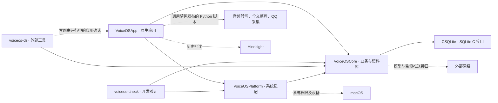

# VoiceOS 架构现状与任务池

基线为日常版源码 `964c164`，依赖以 [Package.swift](../../../Package.swift) 为准。运行时职责以当前实现和正常调用入口为准。该文件随架构治理任务更新。

## 依赖方向

SwiftPM 的 targets 无模块循环。命令行到应用的写回走 URL 协议和回读确认，无编译期依赖。Core 已承载领域规则，同时直接依赖 SQLite、HTTP、CryptoKit 和局部 NaturalLanguage。App 中仍有外部服务接线、部分运行状态与存储读写，编译图不能证明业务边界已清晰。

## 状态所有权

| 概念 | 当前所有者与正常入口 | 应保留的契约 |
| --- | --- | --- |
| 材料、逐字稿、笔记、观点、行动、讨论、主题 | `VoiceOSStore` actor 及其领域扩展写 SQLite。原件在资料库 `assets/`，搜索和工作区读取由 `SearchIndex`、`WorkspaceSnapshot` 等投影提供。 | 原件身份、当前修订、来源归属、用户编辑、历史记录，以及归档或回收状态。 |
| 任务与实际提醒 | 行动状态及提醒意图、许可、回执归 SQLite。Platform 的 EventKit 适配读写 Apple 提醒事项，系统侧状态从回读确认。 | 本地任务与外部提醒分别核实，外部冲突、未知写入结果和反馈历史可追溯。 |
| 应用运行与窗口状态 | `ControlCenter` 启动资料库并协调后台工作，缓存快照并发布给 SwiftUI。 `WorkspaceView` 管页面选择、阅读位置和侧栏。录音收件箱和自动监测另有运行对象。 | 独立资料库窗口有自己的运行状态；列表、详情、搜索、通知和 CLI 跳转同一业务对象。 |
| 个人文本模型配置 | Platform 的 `TextModelConfiguration` 和 `TextModelKeychain` 持久化应用配置及密钥。`LocalTextModel` 还接受外部文件给开发工具和既有用户迁移，`ControlCenter` 决定启动优先级。 | 清除后不回退；损坏与未配置可区分；已有文件格式和钥匙串名称可继续使用。 |
| 转写与整理 | Platform 负责本机录音、Qwen 与处理脚本进程。Core 持久化任务、阶段和有效性；脚本也保存可续跑缓存。 | 转写断点、完整校正稿、全文任务提取及模型阶段回执。 |
| 历史批注与记忆 | App 的 `NoteHistoryMemory` 适配 Hindsight，按库保存同步配置和批注文件，SwiftUI 用段落定位呈现。 | 笔记正文与历史批注独立。此前启用试点的库能继续读取已有配置。 |
| 消息监测 | Core 的 `MessageMonitorRunner` 等处理工作与回执，Platform 运行网页及 QQ 采集，App 的 `MonitorCenter` 管启动、配置、凭据与状态展示。 | 来源各自保有读取和投递进度；网络错误及投递结果可区分。 |
| 备份和跨库读取 | `DatabaseBackup` 管本机 SQLite 备份及原件检查，`PortablePackage` 管独立格式的导出与恢复，`ReadOnlyLibrary` 提供 CLI 的一致快照。 | 导出版本独立于 SQLite schema；只读 CLI 能在应用持有互斥锁时读取，写回仍由应用执行。 |
| UI 样式 | `WorkspaceTheme` 提供颜色，`WorkspaceDesign` 提供通用布局和控件，具体页面持有交互语义。 | 已认可的阅读排版、视觉层级、批注、默认页和快捷操作。 |

## 技术方案与偏离

| 编号 | 发现与证据 | 处理方向 |
| --- | --- | --- |
| A01 · 已验证 | `Database`、`ReadOnlyLibrary`、`DatabaseBackup` 重复直接使用 SQLite C API。写端、读端和迁移测试分别固定当前 schema。 | 迁移到一个 SQLite 连接实现和一个当前 schema 来源，保留连接模式、备份策略和历史迁移。 |
| A02 · 已迁移 | Responses 各领域端口通过构建 `ResponsesModelPort` 复用校验，随后各自构造相同的 HTTP 地址、POST、鉴权和 JSON 请求。 | 让所有端口使用同一个 Responses 请求实现。保留已有超时、请求字节生成方式、传输和持久化失败分类。 |
| A03 · 已验证 | `Database.configure()` 用连续的 `PRAGMA user_version` 查询判断迁移来源，当前库每次打开也遍历条件。当前 schema 写在上限及最后一条历史迁移。 | 把迁移身份和运行顺序集中起来。保留所有历史迁移事务、外键切换和跨版本恢复契约。 |
| A04 · 已统一提醒快照及二级发布 | `ControlCenter` 的全量/按段刷新同时读取 `WorkspaceSnapshot` 和若干独立数据，再分散更新可观察状态。`WorkspaceView` 还持有选中态与导航。 | 先追踪每段读写者，再按刷新数据的所有权归一，保留在用的性能约束与异步导航保护。避免仅切割文件。 |
| A05 · 已移除两个旧视图 | `WorkspaceRow`、`WorkspaceListRow` 以及部分页面自制行共存。 | 逐条核对 hover、选择、焦点、菜单和图标变体，统一语义相同的实现，用两条真实入口验证。 |
| A06 · 已统一资料库路径和模型套件 | `voiceos.sqlite`、应用数据根目录默认值、模型默认 effort 分散在应用、工具、备份和脚本。 | 先处理同一语言内的权威来源。既有启动环境变量和参数是外部契约，应保留。 |
| A07 · 已统一模型请求退避 | 模型同时使用非流式 HTTP、SSE、Python 全文整理及 Hindsight；多处重复错误摘要与重试逻辑。 | 逐一识别同协议同语义的重复。保留传输差异、模型结果未知和可重试的区别，保持凭据和个人正文不进入诊断。 |
| A08 · 已核对测试覆盖，无可安全合并的重复 | Swift tests 已有 121 个文件，另有 Python 流程测试、真实 CLI 验证配方和应用打包脚本；README 的部分架构与行为基线已滞后。 | 已抽查：120 个测试文件、592 项测试无重复测试名；`FollowupDigestChecks` 与 `RetryResilienceChecks` 场景不同，仅共享 74 行样板；三处 `makeStore` 各 5 行，合并会引入跨套件耦合，保留。README 的构建命令、schema 来源、资料库路径与钥匙串口径已核实。边界检查已接入打包入口（见 A12）。 |
| A09 · 已建立授权与凭据地图，归一钥匙串实现 | Apple 权限、云端文字处理许可、模型密钥、记忆身份和消息凭据的合法使用条件分别落在系统、业务状态或单独配置文件。模型密钥与推送地址各写了一份钥匙串 CRUD。 | 核对各授权的写端、读端与恢复入口；两份手写钥匙串 CRUD 归一为 `KeychainCredential`；`NoteHistoryMemory` 只读外部凭据，不并入。云端许可的权威是材料 `local_only` 字段与修订账本。保存范围或默认许可不变。 |
| A10 · 已建立渠道地图并删除无读端诊断 | 启动/HTTP 诊断、持久化业务错误和用户提示各有写端；监测、整理、备份的错误分类缺少同处的调用方地图。`ModelHTTPDiagnostics` 只有写端，没有读者。 | 已核对五类渠道与三类重试语义，未发现可安全合并的重复分类；无读端的 `ModelHTTPDiagnostics` 连同传输层计时一起删除。字符串分类点与子进程错误载体记录在下方地图。 |
| A11 · 已统一行动时间与只读投影 | 部分搜索、外部 CLI、工作区和详情各自读取行动与材料；日期、展示标题和有效性已部分有共享解析。只读 CLI 的列表与详情曾各自重复行动 SQL、到期/计划/提醒查询。 | 从同一个材料或行动沿正常入口核对重复投影，避免把分页与轻量快照强行合并。CLI 列表与详情共用一份投影，隐私字段按需投影。unknown 链接语义待确认。 |
| A12 · 已核对入口分工并加钥匙串边界检查 | 构建、验证和运维入口包括 SwiftPM、`scripts/app`、`scripts/tests`、`voiceos-check`、`voiceos-cli` 和重启脚本。SwiftPM 声明包目标，Python 负责签名与发布资源。 | 已确认一个打包入口（`build.py` 内联运行 `check_architecture.py`），预览启动器与重启闸门各司其职，未发现重复打包路径。新增 SecItem 只允许在 `KeychainCredential` 与 `NoteHistoryMemory` 的机器检查。 |
| A13 · 已统一时间戳格式与解析 | 分数秒 ISO 8601 格式器在 17 个文件手写构造；`ActionTimeFormatting`、`ActionDateFormatting`、`MaterialNaming`、`ReminderSchedule`、`ReminderFields`、`MonitorSourceConfig` 各有一套时间戳实现。 | 归一为 `TimestampFormatting`（isoFractional/iso/parse/dayKey），迁移全部调用方并删除旧载体；`check_architecture.py` 限制 `formatOptions` 只在权威文件出现。真实副本 553 条列表与完整详情 JSON 逐字一致。 |
| A14 · 已统一端口身份校验 | 六个 Responses 端口各自比较 provider/model/promptVersion/schemaVersion 与 destination，同一规则六份实现。 | 归一到 `ModelConfiguration.accepts(_:)`；端口自有身份与请求身份都必须是云端且四字段一致。错误文案与各端口的其余校验保持原样。 |
| A15 · 已删除未使用的 Apple 转写后端 | `NativeSpeechPort`（Apple SpeechAnalyzer）无任何构造点；应用与工具只使用 `LocalQwenSpeechPort`，多处类型判断只认后者。 | 删除该结构体与仅它使用的 `import Speech`。若未来恢复，需先有真实的转写后端选择路径，而不是留着无调用方的实现。 |
| A16 · 已统一应用包发布 | 签名前直接改写旧包，失败后可能留下不完整产物。 | 候选包在同卷组装、严格验证签名后交换目录，发布完成才登记到 LaunchServices。 |
| A17 · 已归一资料权限修订 | 材料详情与录音请求各自插入授权修订和更新资料权限。五处恢复校验各自回查旧权限，凭据指纹在两个入口重复编码。 | `SourcePolicy.swift` 承载修订写入、收据指纹和历史版本核对。原有事务调用方继续决定各自的派生状态失效和提交检查点。边界检查拒绝把这些 SQL 写回其他模块。 |
| A18 · 已归一连续表达校验 | 连续表达的分组核对和失效提示原先各自判断节目配对、节目文字版本与许可。 | 一个校验提供失败原因。阅读仍检查每段可读版本及分组摘要，工作流仍检查保存状态、身份及捕获版本。工作区索引一次得出分组或失效原因。 |
| A19 · 已移除重复目录读取 | 材料快照已经加载全部来源，行动审查和录音跟进曾重复查询并解码逐字稿。双轨录音准备及分组写回曾逐段重扫目录。 | 从完整的当前目录计算工作流分组。保留状态冻结后的重查和部分目录调用方的原契约。异步模型结果返回后读取新目录，后续校验及写回共用该目录。 |
| A20 · 已归一双轨及轻量核查 | 知识核查轻量投影、材料页和录音流程重写了两侧原文版本、配对许可或全文校正判断。 | `RecordingSourceFacts` 让完整记录和轻量查询共用配对及连续表达核对。全文校正门槛共用同一判断。角色及文字可用性用于配对创建与录音流程，材料显示继续依据已保存的版本和许可。 |
| A21 · 已取材料侧栏基线 | `WorkspaceListRow` 的泛型插槽、非交互模式、舒适密度和通用图标分支只有一个在用的实例，材料侧栏和其他列表有各自的交互语义。 | 对照真实侧栏的选择、折叠、重开与悬停，删除无调用方的变体。验证能否复用共同的行交互，同时保留侧栏的选择与布局。 |

## 错误分类与输出渠道（A10）

| 渠道 | 写端 | 读端 | 内容与隐私约束 |
| --- | --- | --- | --- |
| 模型 HTTP 诊断 | 无。`ModelHTTPDiagnostics` 只写不读，已随 A10 删除 | 无 | 模型请求成败由端口错误与调用方状态承载；如未来需要观测，先证明有读端再建载体。 |
| 用户提示 | 各功能在语义所在处构造中文文案（`VoiceOSError`、`ModelDeadlineExceeded`、`RecordingFollowupTransientError` 等） | SwiftUI 状态行、处理页、通知；不解析文案 | 可含材料标题与下一步建议，不含密钥与服务端正文。 |
| 持久化业务状态 | 状态机 outcome（`RecordingInboxOutcome` 的 completed/retryableFailure/deferred/needsAttention）、跟进 evidence、提醒回读异常、模型尝试记录 | 处理页、启动续跑、CLI `status` | 重启后可续跑与核对；分类作为状态保存，诊断正文不进长期库。 |
| 子进程与脚本日志 | Python 整理、转写、QQ 采集的处理日志（如录音目录的 `处理日志.txt`）与 stderr | 处理页错误行、`voiceos-check`、人工排查 | 日志留在资料库或临时目录；不含模型密钥；正文仅限该功能的处理输入。 |
| CLI 输出 | `voiceos-cli` 的 stdout JSON 与 stderr 错误 JSON | 外部自动化 | stdout 只输出 JSON；退出码 0/1/2/3/4/5 分层；参数正文不回显。 |

重试语义分三类，保持分离：

- 同一请求的线级重试：`ResponsesRetry` 负责 429/502/503/504 与瞬时连接错误的 5s/15s 退避，最多三次；写端为 `ResponsesModelPort` 与 `ResponsesRecordingFollowupPort`（后者因结构修复会更换 payload，保留自有循环并复用同一延迟与预算）。
- 操作级结果分类：录音入口把错误归为 deferred/retryableFailure/needsAttention；401/403 需用户处理，408/429/5xx 可重试。错误只在子进程消息边界上可见，`HTTP (\d{3})` 是唯一的字符串解析点（记录在案；升级为结构化载体属于跨 Python/Swift 变更，单列候选）。
- 推送投递：`MonitorPushComposer.validateResponse` 把非 2xx 视为可稍后重试，`MonitorPush` 负责网络错误文案；投递失败由监测循环重投，与模型重试语义不同，保留。

## 授权与凭据（A09）

| 能力 | 权威写端 | 读端 | 恢复与引导入口 | 存储 |
| --- | --- | --- | --- | --- |
| 麦克风 | `NativeDictation.requestPermission()` | `NativeDictation.authorizationStatus()` → `ControlCenter`、引导页 | 引导页与设置「系统权限」；系统设置 | TCC |
| 提醒事项 | `NativeReminders.request()` | `NativeReminders.authorizationStatus()` → 设置、引导、任务页 | `requestFullAccessToReminders()`；系统设置 | TCC / EventKit |
| 系统通知 | `ensureNotifications`（VoiceOSApp） | `notificationSettings().authorizationStatus` → 设置状态行 | `requestAuthorization`；系统设置 | TCC |
| 完全磁盘访问（QQ） | 无程序化请求，TCC 不提供 API | `QQMonitorHelper` 探测可读性 → 处理/监测提示 | 系统设置 → 隐私与安全性；改签名后需重新授权 | TCC |
| 云端文字许可 | 材料策略命令和录音请求通过 `SourcePolicy` 写修订账本 | 各出站调用前的统一校验（`destination != .cloud || 全部 !localOnly`） | 材料详情「允许云端处理」；监测设置开关 | SQLite `sources.local_only` 与修订账本 |
| 模型密钥 | `TextModelKeychain`（现由 `KeychainCredential` 承载） | 模型套件构造时读取 | 设置页模型配置保存/清除 | 钥匙串 `local.voiceos.textmodel` / `apiKey` |
| 历史批注身份 | 外部写入（用户在钥匙串中创建） | `NoteHistoryMemory` 只读 | 钥匙串访问授权；缺失时提示 | 钥匙串 `VoiceOS Hindsight Cloud` / `VoiceOS` |
| 消息推送凭据 | `MonitorCredentialStore`（现由 `KeychainCredential` 承载） | 监测推送发送时读取 | 设置页填写/清除 webhook | 钥匙串 `local.voiceos.app.monitor` / `push.webhook` |

要点：模型密钥与推送地址这两份手写 SecItem CRUD 归一到 `KeychainCredential`（钥匙串服务名、账户名、可访问性与错误文案保持原样）。`NoteHistoryMemory` 读取的是外部创建的凭据且无写路径，不并入通用实现。材料策略命令与录音许可命令共用授权修订写入与指纹。历史问题、关联、相关性、整理意图与分段批次通过同一个查询核对当时的权限，调用方仍保留各自的身份校验与领域错误。

## 构建、验证与运维入口（A12）

| 入口 | 角色 | 关系 |
| --- | --- | --- |
| `scripts/app/build.py` | 唯一产品打包入口：共享构建锁、release 构建、复制资源、签名、App Intents 元数据、图标；开跑前执行 `check_architecture.py` | 发布产物的唯一来源 |
| `scripts/app/run.py` | 开发预览启动器：要求先构建；可指定隔离数据根与限时采集 | 不构建、不打包 |
| `scripts/app/restart_preflight.sh` | 重启闸门：用户空闲与后台任务检查，独立 `VOICEOS_DB` | 运维入口，不构建 |
| `swift build` / `swift test` | 日常编译与全量测试 | 与打包入口共享同一 `Package.swift` |
| `scripts/tests/test_*.py` | Python 流程测试（unittest，19 项） | 与 Swift 测试互不重复 |
| `scripts/tests/check_architecture.py` | 机器可执行的边界规则：CSQLite、Responses URL、资料库路径、SecItem、ISO 8601、资料权限修订 | 打包前强制 |
| `voiceos-check` / `voiceos-cli` | 产品内验证工具与外部只读工具 | 不进打包链 |

## 测试与验证覆盖（A08）

| 层 | 规模 | 说明 |
| --- | --- | --- |
| Swift 单元与流程测试 | 120 个文件、592 项 | 无重复测试名；套件内私有样板不做跨套件合并 |
| Python 流程测试 | 19 项（unittest） | 整理器设置、质量复核、复核转录流 |
| 架构边界检查 | 6 条规则 | 打包前强制（见 A12） |
| CLI 验证配方 | `voiceos-check` / `voiceos-cli` | 真实库副本上的行为对照 |
| 应用实机核对 | 各波次任务记录 | UI 与权限行为以真实应用截图/AX 树为准 |

## 决策记录

- A01 比较过只抽出 SQL statement 方法、给现有 `Database` 增加只读及备份模式、复用单一低层连接。采用单一低层连接，因为只抽方法会留下连接、安全选项与错误处理重复，而在 `Database` 里并列各种模式会让读取者依赖迁移和写配置。SQLite schema 属于 `Database`，导出包格式仍由 `PortablePackage` 管理。

- A02 比较过各端口复用静态请求工厂，以及将校验、凭据、目标地址和 HTTP 请求组成一个值。采用后者，使未校验的地址无法由同一个值构造请求。各端口保留功能对应的输入、响应格式、流式传输和重试。设置测试及双语译文使用相同校验。Python 整理器和 Hindsight 仍按各自的运行时与接口审查。

- A03 比较过只加“已是最新版”快路径、把所有迁移注册为闭包，以及按当前版本分派。采用显式版本分派，SQLite 提供实际起点，每个事务继续同提交写入结束版本；连接建立代码以最终版本完成索引检查。未来版本先拒绝再配置 WAL。

- A06 由 LibraryLayout 保存 Swift 的持久化文件名及默认根，启动参数仍由调用入口解释。应用的资料库和收件箱共用一次路径解析，保留独立窗口名称和 CLI 覆盖优先级。重启运维脚本保留独立的 VOICEOS_DB 入口，避免运维检查依赖启动应用或构建 CLI。

- A07 比较过仅共享状态码、统一同一请求的退避、将所有模型重试交给通用循环。采用同一请求的退避，保留不同功能对连接失败的处理。跟进仍用同一预算计算结构修复与状态重试，持久任务的续跑状态继续由业务层持有。

- A06 的模型部分用唯一的可选套件取代 ControlCenter 的 18 个可独立写入的端口及就绪副本。导入只读取一次文件，构建全部端口成功后才写配置并整体启用。整理器环境和端口身份来自同一组值。现有钥匙串、偏好键和值及外部文件格式保留。

- A04 将提醒异常纳入同一存储快照，移除应用在获得核心快照后再访问一次 store 的窗口。助理和知识核查各有一个发布入口，原有不同刷新计划继续决定续跑和校验时机。

- A05 通过全源引用检查确认旧 DiscussionView 和 WorkspaceTopicTile 没有运行时入口，直接删除。现有讨论使用 WorkspaceDiscussionView，当前主题页继续走正在使用的阅读与导航实现。历史工作记录保留。两种仍在用的 Workspace 行组件各自需要核对交互契约。

- A11 只读 CLI 的列表与详情原各自拼一份行动 SQL，详情再逐项查计划、提醒与到期。改为共享 `actionColumns`/`actionTables` 与 `actionSummary`，一次 JOIN 取齐，详情从同一行构造；删除 `resolvedDue`、`scheduleRow`、`scheduleRecord`、`reminderRecord`。隐私选项由「先查后裁」改为「按需投影列」。用真实副本逐字对照列表与三种详情组合的 JSON，确认对外契约不变；unknown 链接语义继续留在待确认。

- A10 盘点五类输出渠道后发现 `ModelHTTPDiagnostics` 只有写端、没有读者，连同传输层的计时变量一起删除。三类重试语义（同请求线级、操作级结果、推送投递）比较过合并，因预算、payload 与呈现不同而保留分离；子进程字符串分类点记录为后续候选，不在本批改动。

- A09 比较过保留两份钥匙串实现、把模型密钥也搬进 App、以及抽一个低层 `KeychainCredential`。采用低层结构体：两份 CRUD 的 SecItem 形态相同，而服务名、可访问性、错误文案属于各自凭据的契约，留在调用方。`NoteHistoryMemory` 只读外部凭据不并入；三种 Apple 权限各自只有一处请求与状态读取，未发现平行实现，不需要改代码。

- A12 比较过把 Python 测试并进打包入口、与保留独立验证入口。选择保留独立入口，只把边界检查放进打包，因为打包链已经包含构建、签名与元数据，塞入测试会拖长且扩大失败面。钥匙串规则把 A09 的归一变成机器检查，防止第三份手写 SecItem 回潮。

- A08 抽查了两个最像重复的测试文件，确认场景不同、共享的只是样板；三处 makeStore 各五行的样板合并会引入跨套件依赖，按删除检验不值得。测试层的重复不再收敛，覆盖差异改由上方覆盖表记录。

- A13 用探针确认 `withInternetDateTime` 输出不受 `timeZone` 设置影响、分数秒格式不解析无分数时间戳，再归一为单一 `TimestampFormatting`：格式按分数秒与纯秒两档，解析按分数秒→纯秒回退（与原 `MaterialNaming`/`ReflectionTimeline` 的宽容解析一致，`ReminderFields.date` 保持分数秒严格语义）。删除 `ActionTimeFormatting`、`ActionDateFormatting` 的 ISO 对、`MaterialNaming` 静态对、`ReminderSchedule.instantFormatter` 等五套载体，17 个文件净删 69 行。真实副本列表与完整详情 JSON 逐字一致。

- A14 六个端口的身份校验比较过保留、抽自由函数、放到 `ModelConfiguration` 上。采用方法形式，因为规则读的是两个配置值的全部身份字段，且端口配置都由云端目的地构造；`accepts` 同时表达「双方都面向云端」，调用方只保留各自其余校验与错误文案。

- A15 用「类型名在 Sources/Tests 中只出现于定义处」扫描全仓，得到三个候选：App Shortcuts 提供者与 CLI 模块名是系统或模块级名字，保留；`NativeSpeechPort` 无任何构造点，应用各处只认 `LocalQwenSpeechPort`，按删除检验直接删除（41 行）。Git 历史保留实现，恢复时需要真实的转写后端选择路径。

- A16 盘点打包失败路径时发现，旧打包脚本在签名前覆盖正在使用的 dist 目录。比较原地覆盖、先改名后回滚和同卷换目录，采用先在 dist 的临时目录完整组装和校验签名，再一次替换目录。失败的候选包由临时目录清理，已有工作树仍共用原构建锁。

## 待确认的兼容性取舍

- A11：行动时间页排除 unknown 提醒链接作为实际到期依据，只读 CLI 仍可从该链接读取最近观察。普通日期解析与逾期计算可先统一。修改 CLI 的有效到期结果前，区分外部调用使用的原始观察和应用显示的到期日期，明确兼容方式。

- A11 复用 ReminderDueDate 的展示投影，归一行动界面和只读 CLI 的时间、时区及逾期计算。以调用方的日历比较日期，保留既有来源选择及 CLI 对明确无期限的序列化。

- UI 间距与图标尺寸令牌化：约 700 处 padding 字面量与混用的面板宽度、图标尺寸共存，`WorkspaceMetrics` 已承担部分间距令牌。全面令牌化需要先定语义分组（行内、容器、工具条、图标），否则只是形式统一，按待确认处理。

- 环境变量名（`VOICEOS_TEXT_MODEL` 等）在 Swift 与 Python 两侧共同读取，属外部契约。Swift 侧每名约 3 处，抽常量只减字面量不减同步成本；跨语言契约以文档与脚本测试保证，暂不引入常量层。